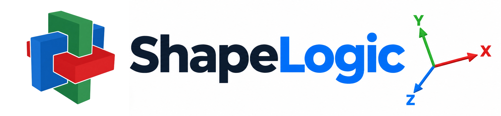

<p align="center">
  
</p>

# ShapeLogic

**ShapeLogic designs and solves mechanical puzzles.** Draw the pieces, draw
the shape they should make, and ShapeLogic finds every way the pieces fit
together. For interlocking puzzles it then works out which of those
assemblies can really be taken apart, and plays the moves back step by step
in 3D. For sliding and stacking puzzles it finds the fewest moves from the
start position to the goal.

Puzzle designers use it to check that a new design has exactly one solution,
to count the moves needed to take it apart, and to export the pieces as STL
files for 3D printing. Puzzle collectors use it to solve, study and share
the puzzles on their shelf.

ShapeLogic is free and open source, and runs on macOS, Windows and Linux.

## Download

Download the installer for your system from the
[**latest release**](https://github.com/shapelogicxyz/shapelogic/releases/latest).

| System | File |
|---|---|
| macOS (Apple silicon or Intel) | `.dmg`, signed and notarised by Apple |
| Windows | `.exe` installer |
| Linux (x64 or ARM) | `.deb` or `.AppImage` |

[Install](https://shapelogic.xyz/docs/install/) in the user guide says which
file fits your computer. Want to look first? Try the
[demo](https://shapelogic.xyz/demo/) in your browser, with nothing to install.

## The puzzles it solves

Every puzzle is built on a grid, the shape of the cells its pieces are made
of. ShapeLogic has nine:

- **[Brick](https://shapelogic.xyz/docs/puzzle-types/brick/)**: pieces made of cubes, as in burrs and box-packing puzzles.
- **[Sliding](https://shapelogic.xyz/docs/puzzle-types/sliding/)**: flat pieces slid around a tray from a start position to a goal, as in Klotski or the 15-puzzle.
- **[Stacking](https://shapelogic.xyz/docs/puzzle-types/stacking/)**: discs moved between rods, as in the Tower of Hanoi and Panex.
- **[Triangular Prism](https://shapelogic.xyz/docs/puzzle-types/triangular-prism/)**: pieces made of prisms with a triangular base, stacked in layers.
- **[Spheres](https://shapelogic.xyz/docs/puzzle-types/spheres/)**: pieces made of balls in the tightest packing, for pyramid and ball-packing puzzles.
- **[Rhombic](https://shapelogic.xyz/docs/puzzle-types/rhombic/)**: pieces made of small tetrahedra cut from cubes, which build rhombic dodecahedra, stellations and diagonally cut cubes.
- **[Tetrahedra-Octahedra](https://shapelogic.xyz/docs/puzzle-types/tetra-octa/)**: pieces made of tetrahedra and octahedra, for tetrahedron and octahedron shaped puzzles.
- **[Hexagonal Prism](https://shapelogic.xyz/docs/puzzle-types/hexagonal/)**: pieces made of hexagonal prisms, a honeycomb stacked in layers (new in ShapeLogic).
- **[Cairo Prism](https://shapelogic.xyz/docs/puzzle-types/cairo/)**: pieces made of prisms on the Cairo pentagonal tiling (new in ShapeLogic).

## The website

[**shapelogic.xyz**](https://shapelogic.xyz) has:

- **[User Guide](https://shapelogic.xyz/docs/)**: how to install ShapeLogic,
  draw shapes, set up a puzzle, solve it and play back the solution, with a
  page for each puzzle type, the command line tool and the code base.
- **[Demo](https://shapelogic.xyz/demo/)**: the app running in your browser,
  opened on a solved puzzle so you can explore before you download.
- **[Research](https://shapelogic.xyz/research/)**: papers on puzzles,
  such as the geometry of golden rhombus puzzles and how the Panex solver
  finds its shortest solutions.
- **News**: what each release adds.

## Where it comes from

ShapeLogic is a fork of [BurrTools](https://burrtools.sourceforge.net/), the
puzzle software by Andreas Röver and contributors, rebuilt from the ground
up: a new solver core in C++23, a new interface, and new puzzle types and
modes. Its algorithms are ported from BurrTools and checked against the
original's answers on a corpus of 180 puzzles. It opens BurrTools'
`.xmpuzzle` files, so existing puzzle collections come straight across.

ShapeLogic is not meant to replace BurrTools, which is still developed and
remains an excellent tool. Use whichever suits the puzzle in front of you, or
both.

## Building and running from the command line

Requirements: CMake 3.28+, Ninja, a C++23 compiler (Apple clang 17+, GCC 13+,
MinGW-w64 GCC 13+), Python 3.10+ and [just](https://github.com/casey/just).
The app also needs Node 22. Optional: LLVM for `just check` / `just format`.

```bash
just build        # build the solver core, engine and command line tool (build/dev)
just test         # unit tests
just app-install  # install the app's packages (once)
just app-dev      # run the app
just oracle       # compare with the original BurrTools (needs ../burr-tools built, or BT_OLD_REPO)
```

`just` on its own lists every recipe, and [AGENTS.md](AGENTS.md) explains
them.

Outputs: `build/<preset>/engine/shapelogic_engine` (the engine: JSON-RPC 2.0 on
stdin and stdout), `build/<preset>/cli/shapelogic_cli` (command-line solver),
`build/<preset>/python/shapelogic.*.so` (the Python module, when CMake
finds Python's headers; `just python-wheel` makes its wheel),
`build/<preset>/tests/bt_tests`.

`shapelogic_cli` solves puzzle files without the app's window:

```bash
shapelogic_cli -d CubeInCage.xmpuzzle      # find the assemblies, check which come apart
shapelogic_cli --json CubeInCage.xmpuzzle  # one line of JSON for scripts
```

[Command line tool](https://shapelogic.xyz/docs/command-line/) in the user
guide explains every option.

## About and Contact

ShapeLogic is free open-source software, built and maintained by Colin
Deisenroth.

- Contact: [shapelogic.xyz@gmail.com](mailto:shapelogic.xyz@gmail.com)
- Submit issues on the [Issues](https://github.com/shapelogicxyz/shapelogic/issues)
  section above
- Find me on the [Mechanical Puzzle Discord](https://discord.com/invite/6cQQV9BTYY) in the `#burr-tools` channel, or
  in a DM to ColinD

## Documentation

- [RELEASE_NOTES.md](RELEASE_NOTES.md): what changed in each release
- [docs/PLAN.md](docs/PLAN.md): stages and status
- [docs/ARCHITECTURE.md](docs/ARCHITECTURE.md): how the code is organised
- [docs/decisions/](docs/decisions/): why it is organised that way
- [docs/webui-spec.md](docs/webui-spec.md): what the web front end does
- [docs/FRONTEND-PLAN.md](docs/FRONTEND-PLAN.md): the plan for building it (stages, gates, what the API lacks)
- [docs/API.md](docs/API.md): the engine's methods and events (generated from [api/](api/))
- [docs/core-api.md](docs/core-api.md): the draft API.md replaced
- [AGENTS.md](AGENTS.md): conventions for everyone working on the code

## Licence

GPL-3.0-or-later (see COPYING). The algorithms are ported from BurrTools by
Andreas Röver and contributors; see AUTHORS.
