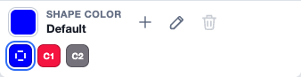
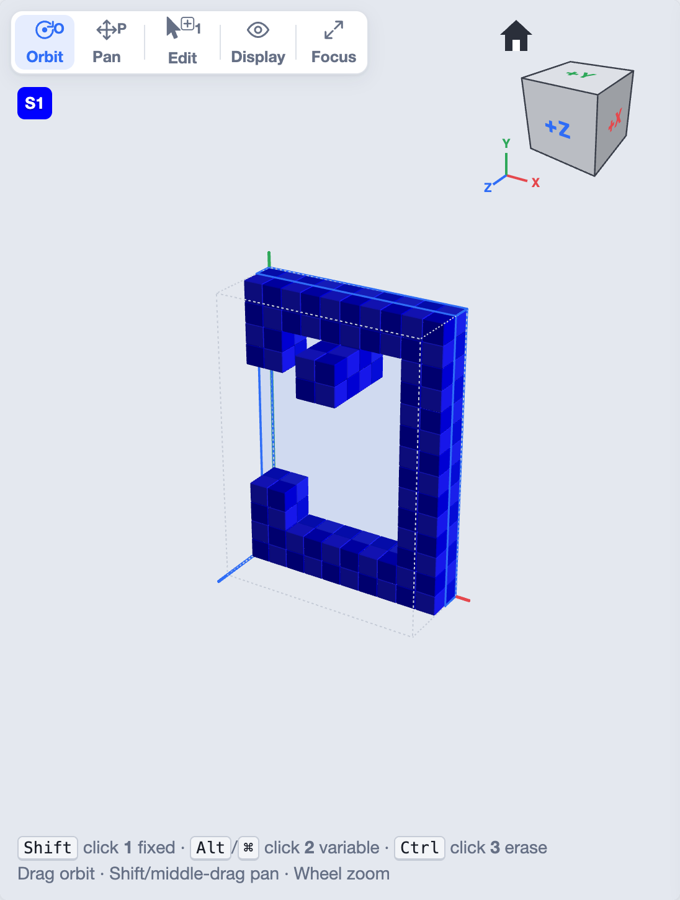
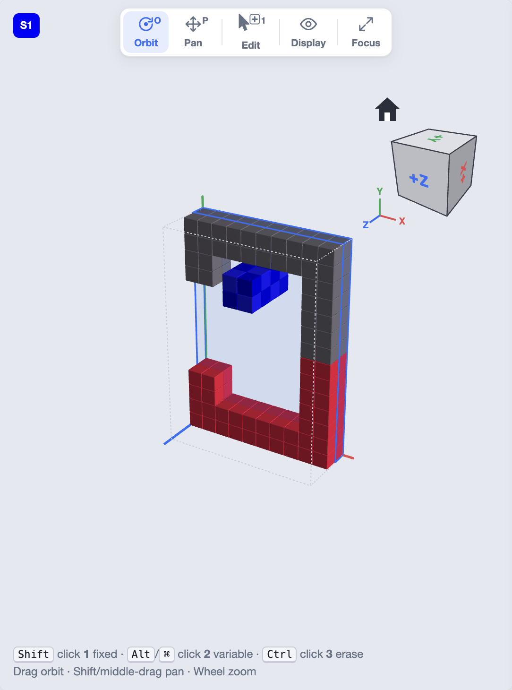

Color restrictions tell the solver that a part of a piece may only go to
certain parts of the result. For example: "the painted face of each piece
must be on the outside of the cube", or "this corner piece must go in a
corner".

They do two things:

- **They limit the assemblies found.** Only assemblies that follow the
  colors count. A puzzle with a printed picture, or with a different color on
  each face, needs this, or the solver would also list assemblies where the
  picture is scrambled.
- **They speed up the solve.** The solver throws away every placement of a
  piece that breaks the rules before the search starts. Fewer placements
  means a smaller search, sometimes a much smaller one.

Color restrictions work in all the normal (assembly) puzzle types. Sliding
puzzles use cell colors for their start marks instead, and stacking puzzles
don't use them.

## Painting constraint colors

Constraint colors are painted onto voxels in the
[voxel editor](/docs/shapes-tab/#shape-and-restriction-colors) on the Shapes tab.

1. Click **+** beside the big color swatch to add a color. Each color you add is a
   constraint color of the whole puzzle.
2. Click the color in the palette to make it the **drawing color**.
3. Use the **Paint** tool (`4`) to color existing voxels, or draw new voxels
   with **Fixed** or **Variable** in that color.

Paint both the pieces and the result. **Default** means no constraint color;
voxels in the default color are **neutral**.

To check where the colors are, choose **Display ▸ Voxel color** in the 3D
view (or **View ▸ Display with Color Constraint Colors**). Every voxel is
drawn in its constraint color instead of the shape's color:

## The color rules

The [Puzzle tab](/docs/puzzle-tab/#color-rules) has a grid of **color
rules** for each problem. Columns are **result** colors, rows are **piece**
colors. A ticked cell lets a piece voxel of the row's color sit on a result
voxel of the column's color.

- **Each color on itself** ticks only the diagonal. This is the usual
  choice: red goes on red, grey on grey.
- **Allow all** ticks every cell.
- **Clear** unticks every cell.

Rules can be one-sided. For example, ticking red-on-red and red-on-grey but
not grey-on-red lets red pieces go anywhere colored, while grey pieces stay
off red.

## Strict Color Restrictions

The Solver tab's search options have a switch called **Strict Color
Restrictions**. It decides how colors are matched, and it is **on by
default**.

### With Strict Color Restrictions on

Colors must match exactly:

- A voxel with a color fits only a result voxel of **the same color**. It
  does not fit a neutral (uncolored) result voxel.
- A neutral voxel fits only a neutral result voxel.
- The color rules grid is **not used**.

This is the simplest way to work. Paint the pieces and the result, and every
color must land on its own color. Neutral parts of the pieces must land on
neutral parts of the result.

### With Strict Color Restrictions off

This is how the original BurrTools matched colors:

- A **neutral** piece voxel fits **any** result voxel, colored or not.
- **Any** piece voxel fits a **neutral** result voxel.
- A colored piece voxel on a colored result voxel needs a ticked cell in the
  **color rules** grid.

So neutral voxels are wildcards, and the rules grid decides the rest. Use
this when only part of the puzzle is colored, for example when only the
outside of the result is painted and the inside doesn't matter, or when you
need rules other than "each color on itself".

### Which to choose

| You want | Use |
|---|---|
| Every colored voxel on its own color, and uncolored on uncolored | Strict on (the default) |
| Only some voxels colored, the rest free to go anywhere | Strict off, with **Each color on itself** |
| A color allowed on several colors, or rules that only go one way | Strict off, with your own rules |
| A puzzle made in BurrTools to solve as it did there | Strict off |

:::caution
The switch is saved with each problem, and the search is built with it.
Changing it on a paused solve throws the paused search away: the results so
far are removed, and the problem has to be solved again.
:::

## Tips

- If a solve finds nothing, check the colors first: switch on **Voxel
  color**, and check that each piece's colors can land somewhere in the
  result.
- Colors on variable voxels count too: a piece can't cover a variable result
  voxel of the wrong color, even though the voxel could stay empty.
- Color restrictions remove placements before the search, so painting even a
  few voxels of a large puzzle can make it much faster to solve.
