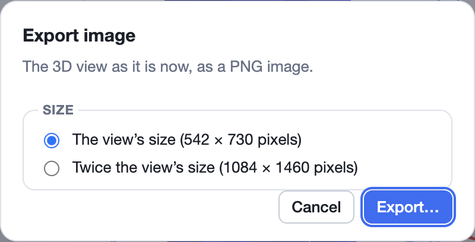
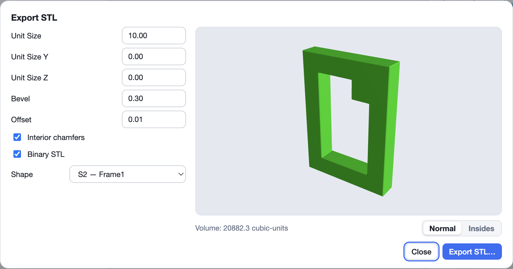
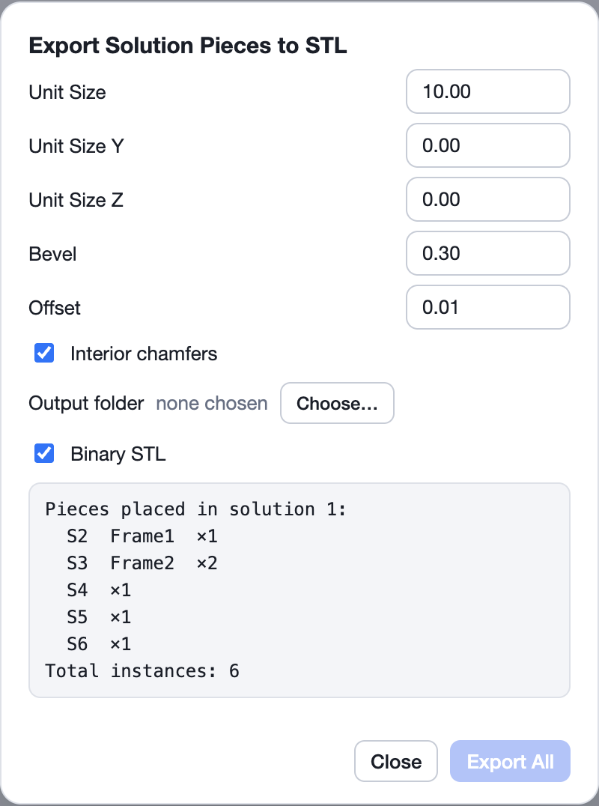
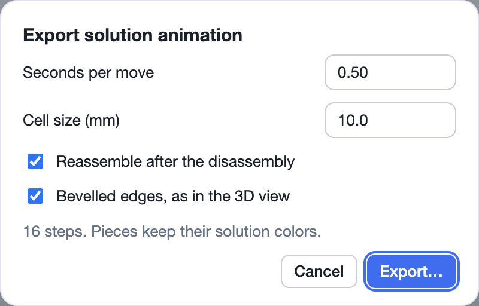

**File ▸ Export** writes the puzzle, or what the 3D view shows, in other
formats. Each export asks for its options, then where to save the file. The
puzzle itself is not changed.

| Item | Writes | Use it to |
|---|---|---|
| **Puzzlecad (OpenSCAD)…** | an OpenSCAD file (`.scad`) | design printable pieces in OpenSCAD with Puzzlecad |
| **Image…** | a PNG picture of the 3D view | share a picture of a shape or a solution |
| **Vector Image…** | an SVG drawing of the 3D view | print, or edit in a drawing program, at any size |
| **STL…** | an STL mesh of one shape (`.stl`) | 3D print a shape |
| **Solution Animation (GLB)…** | an animated 3D model (`.glb`) | show a disassembly in 3D viewers, on the web or in AR |
| **Paused Solver State…** | a paused solve (`.slsolve`) | carry a solve on, on another computer |

An item is greyed out when there is nothing for it to export, for example
**Solution Animation** before a solution is chosen.

## Puzzlecad (OpenSCAD)…

Writes the pieces of the problem shown on the [Puzzle tab](/docs/puzzle-tab/)
as a file for **Puzzlecad**, the OpenSCAD library for designing and 3D
printing puzzles. Each different piece shape is written once (not the
result), as layers of voxels, all in one `burr_plate`, laid out like
Puzzlecad's own examples. Open the file in OpenSCAD with Puzzlecad installed
to render the pieces and export them for printing.

- Only for **brick** (cube grid) puzzles.
- It can be used while a solve is running.

## Image…

Saves the 3D view as it is now as a **PNG** image: the same direction, zoom,
style and colors. Choose the size:

- **The view's size**: the same number of pixels as the view on screen.
- **Twice the view's size**: twice as wide and twice as high, for sharper
  prints and slides.

Set up the view first: turn the model with the [view cube](/docs/viewer/#the-view-cube),
and pick a [style](/docs/viewer/#style).

## Vector Image…

Saves the 3D view as an **SVG** drawing made of flat polygons instead of
pixels. It stays sharp at any size and can be edited in drawing programs
such as Inkscape or Illustrator, for instructions, posters or a puzzle's
packaging. It asks only where to save.

## STL…

Saves one shape as an **STL** mesh for 3D printing or CAD.

- **Shape**: the shape to export. The preview on the right updates as you
  change the settings, and shows the mesh's **volume**.
- **Normal** / **Insides**: show the mesh as it is, or cut open to check its
  inside.
- **Binary STL**: on, a smaller binary file; off, a text file you can read
  in an editor.
- **Export STL…** asks where to save, and **Close** closes the dialog.

The settings for brick, triangular prism, rhombic and tetrahedra-octahedra
grids:

| Setting | Default | What it does |
|---|---|---|
| **Unit Size** | 10 | The size of one voxel along x, and along y and z unless set below. |
| **Unit Size Y** | 0 | The voxel size along y; 0 uses the Unit Size. Bevel and offset stretch with it. |
| **Unit Size Z** | 0 | The voxel size along z; 0 uses the Unit Size. Bevel and offset stretch with it. |
| **Bevel** | 0.3 | The size of the bevel cut on the edges. |
| **Offset** | 0.01 | How far each face is pulled in. A small offset leaves a gap between pieces, so printed pieces fit together. |
| **Interior chamfers** | on | Also bevel the inside (concave) edges, not only the outside ones. |

The settings for sphere grids:

| Setting | Default | What it does |
|---|---|---|
| **Sphere radius** | 10 | The radius of the spheres, which sets how far apart they are. |
| **Connection radius** | 0.75 | The radius of the cylinder joining neighbouring spheres: 1 is the largest, 0 means no connection. |
| **Curvature radius** | 1.0 | The radius of the curve between a sphere and its connection: 1 is the largest. |
| **Offset** | 0 | Makes the spheres a little smaller, by this much. |
| **Recursions** | 2 | How finely the spheres are divided; 3 or 4 is enough. More takes much longer, and more than 6 is refused. |
| **Inner radius** | 0 | The radius of a hollow inside each sphere; it must be smaller than the sphere radius. |
| **Hole diameter** | 0 | The size of the holes in the sphere wall that connect the inside and the outside. |
| **Square Hole** | off | Square holes instead of round ones. |

Shapes with **variable** voxels can't be exported, since a printer can't
make an optional voxel. Make them fixed first, for example with **Repair &
surface ▸ Make fixed** on the [Shapes tab](/docs/shapes-tab/#repair--surface).

To see in the 3D view how the exported pieces will look, choose **Display ▸
Like the STL export**.

### Export Solution Pieces to STL

On the **Solver** tab, **Export to STL** (under the solutions list) writes
**every piece a solution uses**, each as its own STL file, so you can print a
complete set.

- It uses the same settings as **STL…**.
- **Output folder**: click **Choose…** to pick the folder for the files.
- The box lists the pieces of the solution and how many copies of each it
  places. One file is written for each piece shape, named after the shape
  (its name, or its label such as `S4`). Print it as many times as the list
  says.
- **Export All** writes the files. If files of those names are already in
  the folder, ShapeLogic asks before replacing them.

## Solution Animation (GLB)…

Saves the solution chosen on the Solver tab, with its disassembly, as an
animated **GLB** (binary glTF) model. GLB files play in many 3D viewers,
web pages, presentation programs, and in augmented reality on phones.

| Option | Default | What it does |
|---|---|---|
| **Seconds per move** | 0.50 | The time for one move or one 90° rotation (above 0, at most 3600). |
| **Cell size (mm)** | 10.0 | The edge length of one voxel. AR viewers show the puzzle at this real size. |
| **Reassemble after the disassembly** | on | Plays the moves backwards at the end, so the looping animation comes apart and goes back together. |
| **Bevelled edges, as in the 3D view** | on | Off gives plain blocks and a much smaller file. |

The dialog says how many steps the animation has. The pieces keep the
colors they have in the Solver. The solution must have its disassembly
stored: choose one with a ✓ in the **DA** column, or work it out first with
**Manage solutions ▸ Analyse this assembly's disassembly**.

## Paused Solver State…

Saves a paused solve as a **`.slsolve`** file: the puzzle and the state of
the search. Open it with **File ▸ Import ▸ Paused Solver State…** (see
[Imports](/docs/imports/#paused-solver-state)), on this computer or another,
and click **Continue** on the Solver tab to carry the solve on.

- **Pause** the solve of the problem shown on the Solver tab first. The item
  is greyed out while a solve is running.
- For a **stacking** puzzle the file carries the Panex search, packed. If
  the search's saved levels are larger than 1 GB, ShapeLogic asks whether to
  **Include** them or **Leave Out**. Left out, the file is much smaller, but
  finding the path at the end of the search takes longer.

Saving the puzzle with **File ▸ Save** also keeps a paused solve, so you
only need this export to move a solve to another computer, or to keep it
apart from the puzzle file.
