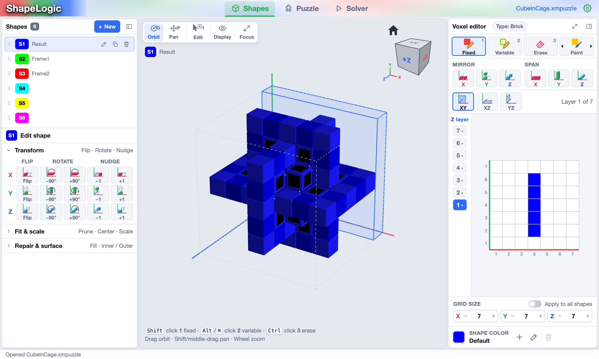
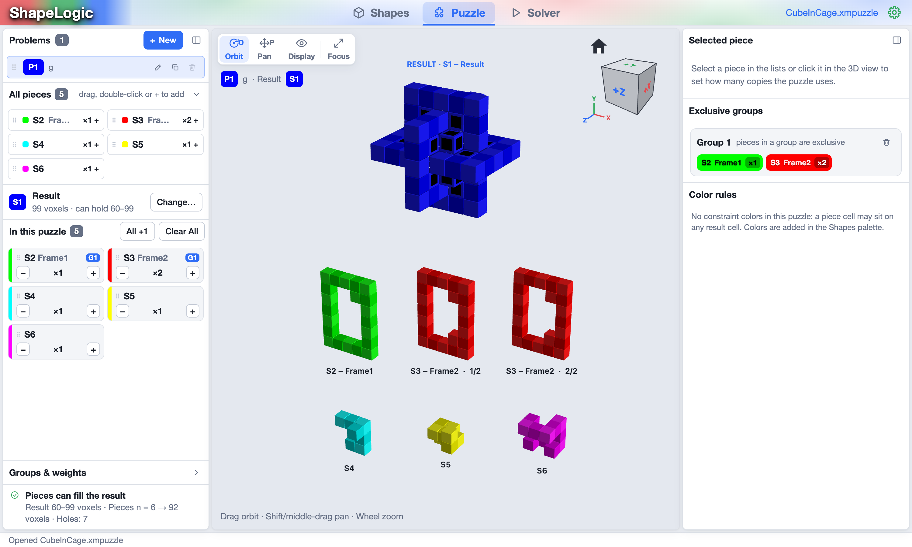
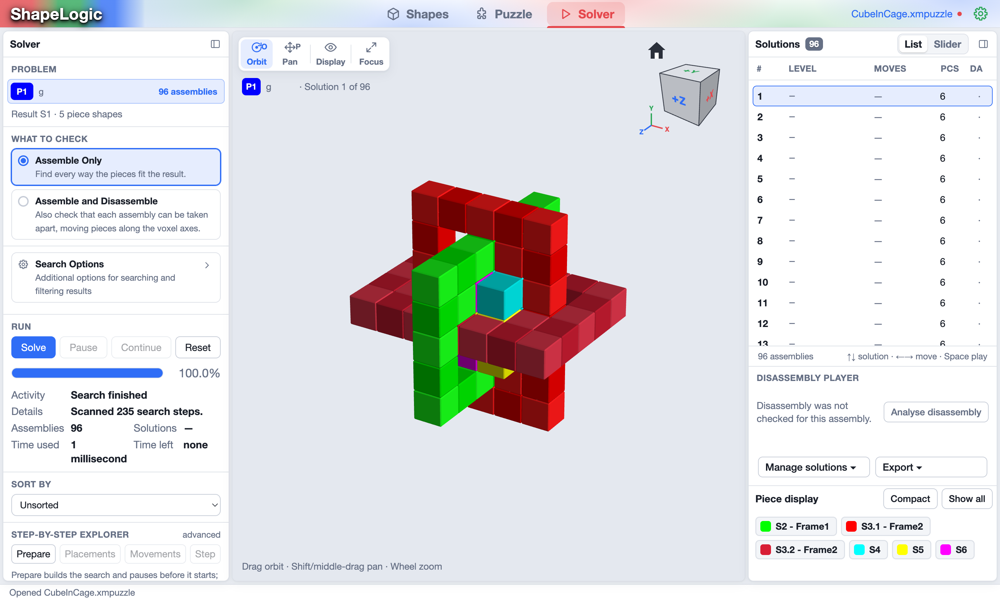

This tour opens an existing puzzle, looks at each of the three workspaces and
solves it. It takes about five minutes.

## Open a puzzle

Download [CubeInCage.xmpuzzle](/examples/CubeInCage.xmpuzzle), then choose
**File ▸ Open** and pick it. The file name appears at the top right of the
window.

The tabs in the middle of the top bar switch between **Shapes**, **Puzzle**
and **Solver** (`Ctrl+1`, `Ctrl+2`, `Ctrl+3`; `⌘` on a Mac). A puzzle moves through
them in that order: you draw the pieces, say which pieces make up the puzzle,
then solve it.

## Shapes: draw the pieces

A puzzle is built from **shapes**. Each is a block of voxels (cells), and a
shape can be a piece of the puzzle or the result the pieces must fill.

- The **Shapes** list on the left holds every shape (S1, S2, …). Select one to
  see it in the 3D view.
- The **Edit shape** panel below it flips, rotates and nudges the whole shape,
  scales it, and repairs it.
- The **voxel editor** on the right is where you draw. Pick a tool (Fixed,
  Variable, Erase or Paint), then click or drag cells in the layer grid.
  Change layers with the **Z layer** strip or `PgUp` / `PgDn`.
- In the 3D view, drag to orbit, hold `Shift` and drag to pan, and scroll to
  zoom. The cube in the corner turns the view to any face when you click it.

A **fixed** cell must be filled by a piece, and a **variable** cell may or may
not be.

## Puzzle: choose what to solve

A **problem** says which shape is the **Result** and how many copies of each
piece the puzzle uses.

- **All pieces** lists every shape you can use. Drag one in, double-click it, or
  press **+**.
- **In this puzzle** shows each piece with its count. Use **−** and **+** to
  change it, or give a range such as 0–6 and let the solver try every count.
- **Result** names the shape the pieces must fill. **Change…** picks another.
- The check at the bottom tells you whether the pieces can fill the result at
  all.

## Solver: find the assemblies

Switch to the **Solver**.

1. Under **What to check**, leave **Assemble Only** selected to find every way
   the pieces fit the result. Choose **Assemble and Disassemble** to also check
   that each assembly can be taken apart.
2. Press **Solve**. The progress bar and the **Assemblies** count update while
   it runs, and **Pause**, **Continue** and **Clear** stop and resume the search.
3. When it says **Finished**, the **Solutions** list on the right shows what
   it found. CubeInCage has 96 assemblies. Click a row to see it in the 3D view,
   or use `↑` and `↓` to step through them.
4. The **Piece display** chips at the bottom right show or hide individual
   pieces, so you can look inside an assembly.

With **Assemble and Disassemble**, each solution gets a level and a number of
moves, and the **Disassembly player** replays how the pieces come apart.
**Export to STL** writes the pieces out for 3D printing.

## Make it yours

**Settings ▸ General** (`Ctrl+,`, or `⌘,` on a Mac) sets how the window
looks. Changes apply at once.

- **Interface density**: **Standard** (the default); **Compact**, Standard
  with shorter rows in the shapes, problems and solutions lists, so about
  twice as many fit, and on the Shapes tab each control on one line, its
  icon beside its caption, with the action buttons' descriptions in their
  tooltips; or **Minimal**, icons without captions, helper text in
  tooltips, and the 3D view's toolbar hidden until you point at the bottom
  of the view. Every function is there in all three.
- **Font size**: **Small**, **Medium** (the default) or **Large**, each about
  2 points larger than the one before. The text keeps its size in every
  density.
- **Sidebar width**: **Variable** (the default) widens the left and right
  cards as the window grows past 1600 pixels, the right card always 10%
  wider than the left; **Static** keeps them at the widths you set (200 to
  600 pixels each).
- **Main tab bar location**: **Top** puts the Shapes, Puzzle and Solver tabs
  in the middle of the top bar (the default); **Left** puts them in a rail
  down the left side of the window.
- **Theme**: **Light**, **Dark**, or **System** (the default), which follows
  your computer's setting. **View ▸ Color Theme** switches it too.
- **Top bar theme**: **Colorful** (the default) puts the red, green and blue
  of the X, Y and Z axes behind the ShapeLogic name and colors the tabs:
  Shapes green, Puzzle blue, Solver red. **Boring** keeps the bar plain, with
  a small colored square beside the name.

At the bottom of the page, **Cache folder** says where the solver keeps
its cache data, which can take a lot of disk space: what a sliding search
writes to disk once it outgrows its memory, and the saved sliding and
stacking searches that **Continue** carries on, in a `sliding` and a
`panex` folder. By default they are in ShapeLogic's folder in your system's
application data folder:

| System | Default cache folder |
|---|---|
| macOS | `~/Library/Application Support/ShapeLogic` |
| Windows | `%LOCALAPPDATA%\ShapeLogic` |
| Linux | `$XDG_DATA_HOME/shapelogic`, or `~/.local/share/shapelogic` |

- **Choose Folder…** picks another folder, on a larger disk for example.
  ShapeLogic makes a `ShapeLogic` folder inside it, with a `sliding` and a
  `panex` folder, and checks at once that it can write there. If it
  can't (you don't have permission to write in that folder), it says so and
  keeps the cache folder it was using.
- If the cache folder in use holds data, ShapeLogic says what it found (for
  example "2 saved sliding searches (1.2 GB)") and asks whether to **Move
  Data** to the new folder or **Delete and Start Clean**.
- **Use Default** goes back to the default folder, asking the same question.
- The cache folder can't be changed while a solve is running: pause or stop
  it first. **Reset section** and **Restore all defaults** leave it as it is.
- If the chosen folder can't be written when ShapeLogic starts (a disk that
  is not connected), ShapeLogic goes back to the default folder and tells
  you.
- The [command line tool](/docs/command-line/) keeps its own folders, set
  by its environment variables.

### Managing the cache and autosave files

**View ▸ Manage Cache and Autosave Files…** lists what solves, pauses, the
crash recovery journal and crashes have left on the disk, by name rather
than by file name: "Paused sliding solve of Block 15.xmpuzzle, Main", say,
or "Crash recovery copy of Untitled". Each item can be several files: the
saved searches of all the starts of one sliding problem are one item.

Select an item to see below the list what it is, the disk space it takes,
the puzzle file and problem it belongs to, when it was made and last
written, and every file it is, by its full path. **Delete…** removes it
from the disk after asking. Searches can't be deleted while a solve is
running; a paused solve whose search you delete starts that search again
from the beginning when you continue it. **Refresh** lists the files again.

ShapeLogic records which puzzle a search belongs to when the search is
saved. Searches saved by an earlier version, or by a puzzle never opened
since, show "puzzle not known" until you open that puzzle again.

## Next

You have seen the whole loop: shapes, a problem, a solve. A guide to building a
puzzle from scratch is coming next.
