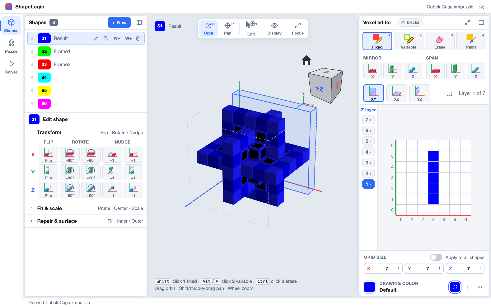
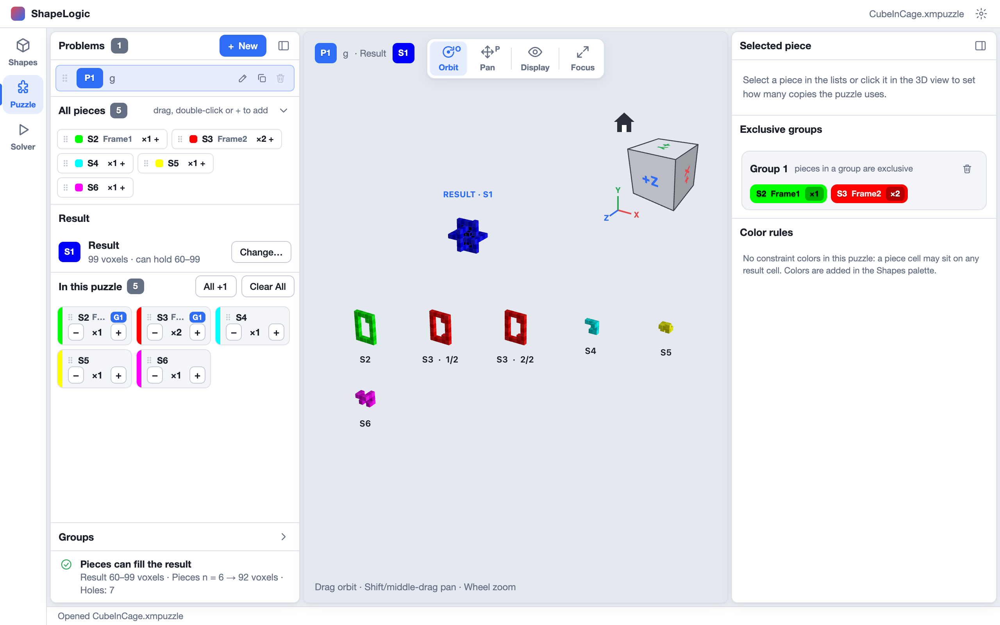
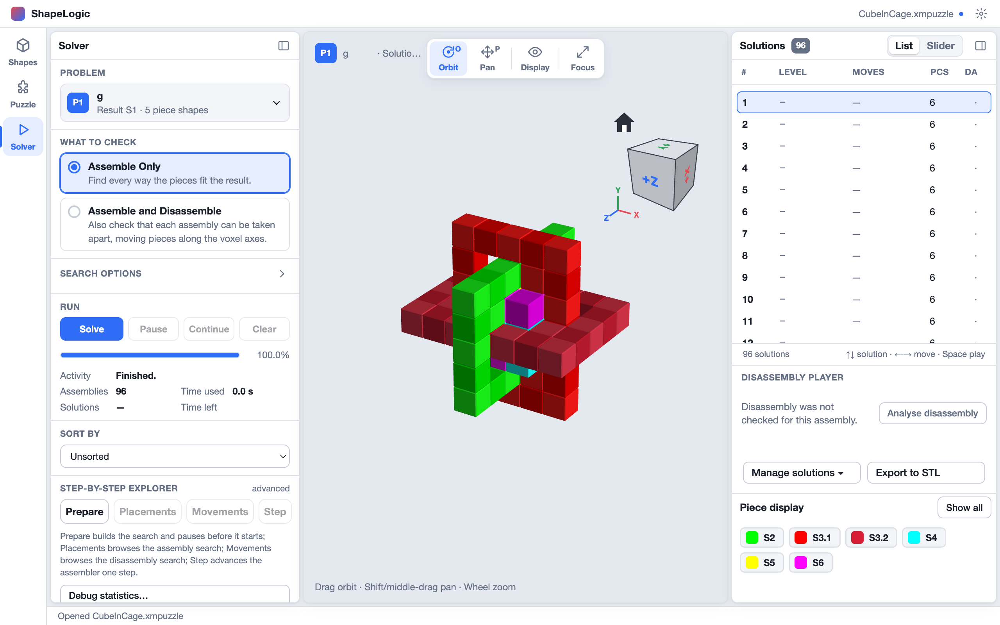

This tour opens an existing puzzle, looks at each of the three workspaces and
solves it. It takes about five minutes.

## Open a puzzle

Download [CubeInCage.xmpuzzle](/examples/CubeInCage.xmpuzzle), then choose
**File ▸ Open** and pick it. The file name appears at the top right of the
window.

The workspace rail on the left switches between **Shapes**, **Puzzle** and
**Solver** (`Ctrl+1`, `Ctrl+2`, `Ctrl+3`; `⌘` on a Mac). A puzzle moves through
them in that order: you draw the pieces, say which pieces make up the puzzle,
then solve it.

## Shapes: draw the pieces

A puzzle is built from **shapes**. Each is a block of voxels (cells), and a
shape can be a piece of the puzzle or the result the pieces must fill.

- The **Shapes** list on the left holds every shape (S1, S2, …). Select one to
  see it in the 3D view.
- The **Edit shape** panel below it flips, rotates and nudges the whole shape,
  scales it, and repairs it.
- The **voxel editor** on the right is where you draw. Pick a tool (Fixed,
  Variable, Erase or Paint), then click or drag cells in the layer grid.
  Change layers with the **Z layer** strip or `PgUp` / `PgDn`.
- In the 3D view, drag to orbit, hold `Shift` and drag to pan, and scroll to
  zoom. The cube in the corner turns the view to any face when you click it.

A **fixed** cell must be filled by a piece, and a **variable** cell may or may
not be.

## Puzzle: choose what to solve

A **problem** says which shape is the **Result** and how many copies of each
piece the puzzle uses.

- **All pieces** lists every shape you can use. Drag one in, double-click it, or
  press **+**.
- **In this puzzle** shows each piece with its count. Use **−** and **+** to
  change it, or give a range such as 0–6 and let the solver try every count.
- **Result** names the shape the pieces must fill. **Change…** picks another.
- The check at the bottom tells you whether the pieces can fill the result at
  all.

## Solver: find the assemblies

Switch to the **Solver**.

1. Under **What to check**, leave **Assemble Only** selected to find every way
   the pieces fit the result. Choose **Assemble and Disassemble** to also check
   that each assembly can be taken apart.
2. Press **Solve**. The progress bar and the **Assemblies** count update while
   it runs, and **Pause**, **Continue** and **Clear** stop and resume the search.
3. When it says **Finished**, the **Solutions** list on the right shows what
   it found. CubeInCage has 96 assemblies. Click a row to see it in the 3D view,
   or use `↑` and `↓` to step through them.
4. The **Piece display** chips at the bottom right show or hide individual
   pieces, so you can look inside an assembly.

With **Assemble and Disassemble**, each solution gets a level and a number of
moves, and the **Disassembly player** replays how the pieces come apart.
**Export to STL** writes the pieces out for 3D printing.

## Next

You have seen the whole loop: shapes, a problem, a solve. A guide to building a
puzzle from scratch is coming next.
