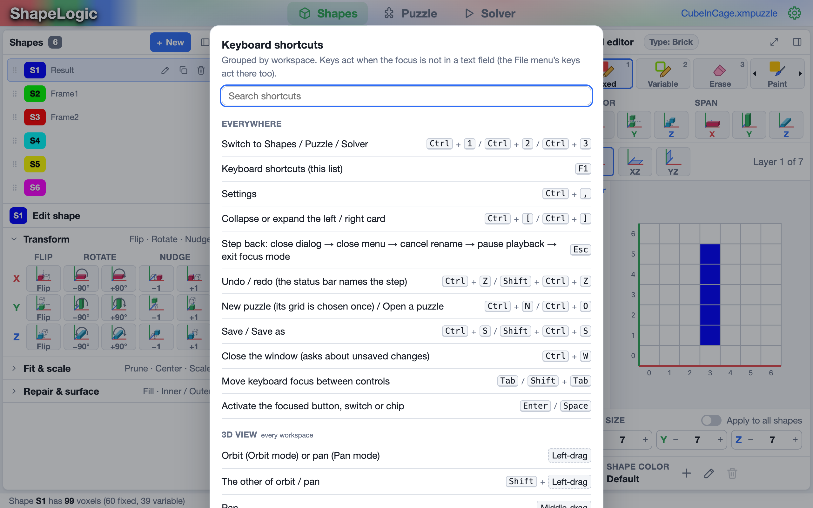

Press `F1` (or **Help ▸ Keyboard Shortcuts**) in the app for this list. It
has a search box, so you can type part of an action or a key to find it.

## Windows, Linux and macOS

The keys are the same on every system, with these changes on a Mac:

- **`Ctrl` becomes `⌘` (Command)** for the shortcuts that hold it: `⌘S`
  saves, `⌘Z` undoes, `⌘1` switches to the Shapes tab, and so on.
  ShapeLogic also accepts `Control` for these, so `Control+S` works too.
- **`Alt` is `⌥` (Option).**
- **On a Mac laptop**, use `fn` for the keys it doesn't have: `fn+⌫` for
  `Del`, `fn+←` and `fn+→` for `Home` and `End`, `fn+↑` and `fn+↓` for `PgUp`
  and `PgDn`. Depending on your keyboard settings, `F1` and `F2` may also need
  `fn`.
- **Settings** is in the **ShapeLogic** menu (`⌘,`); on Windows and Linux it
  is **Edit ▸ Settings…** (`Ctrl+,`).
- **Quit** with `⌘Q`. On Windows and Linux, use **File ▸ Exit**, or close the
  window.

On **Linux**, some desktops use `Alt`+click or `Alt`+drag to move windows.
If `Alt`+click does nothing in ShapeLogic, use the **Variable** tool (`2`)
instead, or change the desktop's window-moving key in its settings.

## Everywhere

| Action | Windows and Linux | macOS |
|---|---|---|
| Switch to Shapes / Puzzle / Solver | `Ctrl+1` / `Ctrl+2` / `Ctrl+3` | `⌘1` / `⌘2` / `⌘3` |
| Keyboard shortcuts (this list) | `F1` | `F1` |
| Settings | `Ctrl+,` | `⌘,` |
| Collapse or expand the left / right card | `Ctrl+[` / `Ctrl+]` | `⌘[` / `⌘]` |
| Step back: close a dialog, then a menu, cancel a rename, pause playback, leave focus mode | `Esc` | `Esc` |
| Undo / redo | `Ctrl+Z` / `Shift+Ctrl+Z` | `⌘Z` / `Shift+⌘Z` |
| New puzzle / open a puzzle | `Ctrl+N` / `Ctrl+O` | `⌘N` / `⌘O` |
| Save / save as | `Ctrl+S` / `Shift+Ctrl+S` | `⌘S` / `Shift+⌘S` |
| Close the window (asks about unsaved changes) | `Ctrl+W` | `⌘W` |
| Move keyboard focus between controls | `Tab` / `Shift+Tab` | `Tab` / `Shift+Tab` |
| Press the focused button, switch or chip | `Enter` / `Space` | `Return` / `Space` |

The undo and redo steps are named in the **Edit** menu and the status bar.
The **File** shortcuts also work while you are typing in a text field; the
others don't.

## 3D view

These work in every tab. See [3D Model Viewer](/docs/viewer/).

| Action | Windows and Linux | macOS |
|---|---|---|
| Orbit (in Orbit mode) or pan (in Pan mode) | Left-drag | Drag |
| The other of orbit and pan | `Shift`+left-drag | `Shift`+drag |
| Pan | Middle-drag | Middle-drag (on a trackpad: `Shift`+drag, or Pan mode) |
| Zoom | Mouse wheel | Mouse wheel, or two-finger scroll |
| Orbit mode / Pan mode | `O` / `P` | `O` / `P` |
| Home view: default direction, fitted | `Home` | `Home` (`fn+←`) |
| Fit the model to the view, direction kept | `F` | `F` |
| Turn to a face, edge or corner | Click it on the view cube | Click it on the view cube |
| Look straight at a face, label upright | Double-click a view cube face | Double-click a view cube face |
| Show the hidden toolbar (Minimal density) | Point at the bottom of the view, or `Tab`, `O`, `P`, `E`, `F` | The same |

## Shapes tab

See [Shapes Tab Options](/docs/shapes-tab/).

### Drawing

| Action | Windows and Linux | macOS |
|---|---|---|
| Tool: Fixed / Variable / Erase / Paint | `1` / `2` / `3` / `4` | `1` / `2` / `3` / `4` |
| 3D edit mode (on and off): a click uses the active tool | `E` | `E` |
| Add a fixed voxel, whatever the tool (3D view and grid) | `Shift`+click | `Shift`+click |
| Add a variable voxel, whatever the tool | `Alt`+click | `⌥`+click or `⌘`+click |
| Erase a voxel, whatever the tool | `Ctrl`+click | `Control`+click |
| Erase in the 2D grid | Right-click or right-drag | Right-click or two-finger click |
| Use the tool on every cell you drag across (one undo step) | Drag in the grid | Drag in the grid |
| Next / previous layer | `PgUp` / `PgDn` | `PgUp` / `PgDn` (`fn+↑` / `fn+↓`) |
| Cancel a box selection | `Esc` | `Esc` |

### Shapes list

These work while the shapes list has the keyboard focus (click in it first).

| Action | Windows and Linux | macOS |
|---|---|---|
| Previous / next shape | `↑` / `↓` | `↑` / `↓` |
| Move the shape earlier / later | `Alt+↑` / `Alt+↓` | `⌥↑` / `⌥↓` |
| Rename the shape (`Enter` saves, `Esc` cancels) | `F2`, `Enter` or double-click | `F2`, `Return` or double-click |
| Delete the shape | `Del` | `fn+⌫` |
| Duplicate the shape | `Ctrl+D` | `⌘D` |
| Shape menu | Right-click a row | Right-click or `Control`+click a row |
| Reorder | Drag a row | Drag a row |

## Puzzle tab

See [Puzzle Tab Options](/docs/puzzle-tab/).

| Action | Windows and Linux | macOS |
|---|---|---|
| One more / one fewer copy of the selected piece | `+` / `−` | `+` / `−` |
| Remove the selected piece from the puzzle | `Del` | `fn+⌫` |
| Add one copy from All pieces | Double-click a chip, or its **+** | The same |
| Add a piece / remove it | Drag a chip in / drag a tile out | The same |
| Piece menu: one more, one fewer, remove, set as result | Right-click a tile or chip | Right-click or `Control`+click |
| Select a piece | Click it in the 3D view | Click it in the 3D view |

## Solver tab

These work while the solutions list, the solution slider or the move bar has
the keyboard focus. Orbiting or clicking in the 3D view keeps the focus in
the Solutions card. See [Solver Tab Options](/docs/solver-tab/).

| Action | Windows and Linux | macOS |
|---|---|---|
| Play / pause the disassembly | `Space` / `Enter` | `Space` / `Return` |
| One move back / forward | `←` / `→` | `←` / `→` |
| Jump to assembled / fully apart | `Shift+←` / `Shift+→` | `Shift+←` / `Shift+→` |
| Previous / next solution | `↑` / `↓` | `↑` / `↓` |
| First / last solution (on the move bar: start / end of the moves) | `Home` / `End` | `fn+←` / `fn+→` |
| 8 solutions back / forward | `PgUp` / `PgDn` | `fn+↑` / `fn+↓` |
| Remove the selected solution (asks first) | `Del` | `fn+⌫` |
| Pause playback | `Esc` | `Esc` |
| Select a solution and play it | Double-click its row | Double-click its row |
| Sort the list; again to reverse | Click a column header | Click a column header |
| Piece chip: cycle solid, wireframe, hidden / move between chips | `Space` or `Enter` / `←` `→` | `Space` or `Return` / `←` `→` |

## Explorers

The step-by-step explorers open below the 3D view on the Solver tab. These
keys work while the explorer has the keyboard focus.

| Action | Keys |
|---|---|
| Placements: previous / next placement | `↑` / `↓` |
| Placements: previous / next piece | `←` / `→` |
| Placements: first / last placement | `Home` / `End` |
| Step: one step of the assembler | `Space` / `Enter` |
| Movements: previous / next position | `↑` / `↓` |
| Movements: back to the parent / to its first move | `←` / `→` |
| Movements: analyse the position | `Enter` |
| Movements: the first move that takes a piece that way | `Alt`+drag the piece in the 3D view (`⌥`+drag on a Mac) |
| Close the explorer | `Esc` |

## Dialogs and menus

| Action | Keys |
|---|---|
| Close the dialog or menu | `Esc` |
| Save a rename or a number field | `Enter` (`Return` on a Mac) |
| Toggle the focused switch | `Space` / `Enter` |
