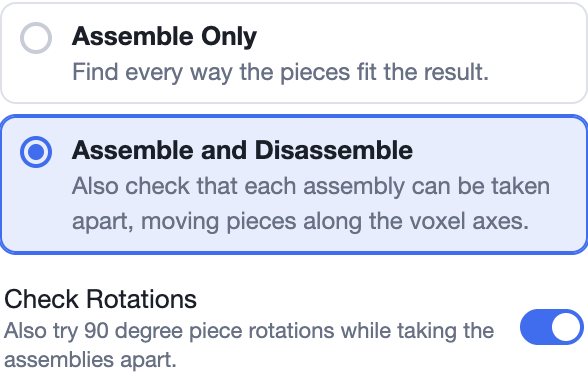
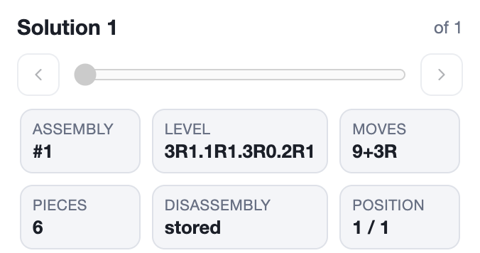

Most interlocking puzzles come apart by **sliding** pieces in straight lines.
Some need a piece to **turn**: a quarter twist that unhooks it from its
neighbours before it can slide out. Puzzle makers call these **TICs**
(Turning Interlocking Cubes), or rotational puzzles.

By default ShapeLogic only tries sliding moves. Such a puzzle would be
reported as impossible to take apart, or found with a much longer solution
than it really has. **Check Rotations** tells the solver to try turns too.

## Turning on Check Rotations

On the [Solver tab](/docs/solver-tab/), choose **Assemble and Disassemble**,
then switch on **Check Rotations**.

- It needs **Assemble and Disassemble**: rotations are only used while
  taking assemblies apart.
- It can't be combined with **Just Count**, which doesn't take assemblies
  apart.
- Turning on **Just Levels** switches it off. You can switch it back on.
- It works on the brick (cube) grids. Pieces turn by 90° about the x, y or z
  axis.

With it on, each step of the take-apart can be:

- a **slide**: one piece, or a group of pieces, moves one or more cells along
  an axis, as usual; or
- a **rotation**: one piece, or a group of pieces, turns by 90° about an axis
  through a pivot point, if nothing is in the way of the turn.

The solver checks the whole path of a turn, not only where the piece ends up,
so a piece can't turn through a neighbour.

## Reading the results

Solutions with rotations show them in the solutions list:

- **Moves** shows slides and rotations apart: `9+3R` is 9 slides and 3
  rotations.
- **Level** shows both for each piece that comes free: `3R1` means 3 slides
  and 1 rotation. When any rotation is used, every part of the level uses
  this form, so you may see `R0` where no turn was needed.
  [Solve Notation](/docs/solve-notation/#levels-with-rotations) explains this
  in full.
- **Sort by ▸ Rotations** keeps the solutions with the most rotations first.

The disassembly player animates the turns, so you can watch each twist.

## Why it is slower

For every position in the take-apart, the solver must try turning every
piece, and every group of pieces, about every axis, through every possible
pivot, both ways. That is many more moves to try than slides alone, and each
turn has to be checked along its whole path. A puzzle that takes seconds
without rotations can take minutes or hours with them.

Some ways to keep it manageable:

- Use **Just Levels** to keep only the levels, then analyse the moves of the
  solutions you want with **Manage solutions ▸ Analyse this assembly's
  disassembly** (with Check Rotations switched back on).
- Try the **Fast (Crowell)** solver type (below).

## The two solver types

The **Solver type** menu in the search options picks how the take-apart is
done. Both solvers find exactly the same **assemblies**. They differ only in
how hard they look for a way to take each one apart, which matters most when
**Check Rotations** is on.

### Complete (ShapeLogic)

Formerly **BurrTools Classic**. This is the default, and a **complete**
search. With Check Rotations on, it tries every turn of every piece and group
of pieces about every pivot. If a disassembly exists, it finds it. It
searches breadth first, so each piece comes free in the fewest moves
possible.

Choose it when you need certainty: to prove that an assembly can't be taken
apart, or to find the shortest disassembly.

### Fast (Crowell)

Formerly **Andrew Crowell**. This take-apart follows the methods of Andrew
Crowell's rotational puzzle solver. It saves time by trying only the most
promising turns:

- it doesn't try to turn the largest remaining piece, since the others
  usually turn around it;
- it tries fewer pivot points for each turn;
- it stops looking for more turns in a direction once it has found a few.

It is often much faster on puzzles with many pieces and rotations. The cost
is that it can **miss** a disassembly that needs one of the turns it skipped.
An assembly it can't take apart might still come apart. A solution it finds
might not be the shortest one.

### Which to use

| Situation | Use |
|---|---|
| A first look at a big rotational puzzle | Fast (Crowell) |
| Proving an assembly can't come apart | Complete (ShapeLogic) |
| Finding the fewest moves | Complete (ShapeLogic) |
| Puzzles without Check Rotations | Either; the difference is small |

A good way to combine them on a large puzzle:

1. Solve with **Assemble Only**, so every assembly is kept.
2. With **Check Rotations** on and **Fast (Crowell)** chosen, use **Manage
   solutions ▸ Analyse the disassembly of every assembly**.
3. Switch to **Complete (ShapeLogic)** and use **Manage solutions ▸ Analyse
   only the missing disassemblies**. This checks again only the assemblies
   the fast solver could not take apart.
