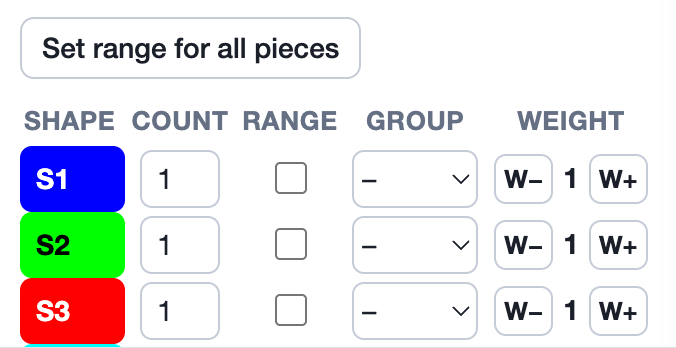

Each shape has a **weight**. The weight decides which pieces stay still and
which ones move when the solver takes an assembly apart. Use it to make the
moves look the way you would make them by hand. For example, you can hold a
frame or a box still while the pieces slide out of it.

Weights only change how the take-apart is shown. They don't change which
assemblies are found or whether one can be taken apart. They don't change
the level or the number of moves either.

## Setting a weight

Open the **Groups** section of the [Puzzle tab](/docs/puzzle-tab/#groups).
Each piece in the puzzle has a **Weight** column with two buttons and the
weight between them:

- **W+** adds 1 to the shape's weight, making it heavier.
- **W−** takes 1 from it, making it lighter. The lowest weight is 0, and
  **W−** is greyed out there.

The table lists only the pieces in the puzzle. To weigh a shape that isn't
in it, use the [shape menu](/docs/shapes-tab/#the-shapes-list) in the
Shapes tab (right-click a row): **Weight +1** and **Weight −1**.

Every shape starts at weight **1**. A piece with any other weight shows it
at the bottom of its tile under
[In this puzzle](/docs/puzzle-tab/#in-this-puzzle), such as **Weight: 3**
or **Weight: 0**. A weight belongs to the shape, so every piece made from
that shape has it, in every problem. It is saved in the puzzle file, in the
same form BurrTools uses.

Stacking puzzles have no weights, and their Groups table has no **Weight**
column.

## How the solver uses weights

Weights are used when the Solver tab is set to **Assemble and Disassemble**.
At each step of a take-apart, the solver splits the pieces into two groups:
the pieces that move and the pieces that don't. Moving one group left looks
the same as moving the other group right, so the solver can pick which
group to show moving:

1. It finds the heaviest piece in each group. A group is as heavy as its
   heaviest piece; the other pieces' weights don't add to it.
2. The group with the heavier piece **stays in place**, and the other group
   moves.
3. If both groups are equally heavy, the solver keeps the group it found
   moving. This is usually the smaller group.

This also applies when pieces are taken out: when a group comes free of the
rest, the heavier side stays and the lighter side is removed.

With every shape at weight 1, all groups weigh the same, so the solver
always moves the group it found. That can look odd, for example a frame
sliding off a piece instead of the piece sliding out of the frame.

:::note
Weights apply to slides and removals. Turns, with **Check Rotations** on
(see [Piece Rotations](/docs/piece-rotations/)), don't follow the weights.
:::

## Examples

- **A frame or box that should stay still.** Give the frame **W+** once, to
  weight 2. Every group that holds the frame now stays in place, and the
  pieces come out of it.
- **One piece that should always be the one to move.** Give it **W−**, to
  weight 0. Any group without it weighs at least 1, so the group that holds
  it moves. This doesn't help if every other piece is also at 0.
- **An order among several pieces.** Give each one a different weight, for
  example base 3, frame 2, the rest 1. When two of them are in different
  groups, the heavier one stays.

## Tips

- The weights are read when the solve runs. After changing them, solve again
  to see the new moves.
- Only the order of the weights matters, not the gap between them. Weights
  2 and 10 do the same thing next to a group of weight 1.
