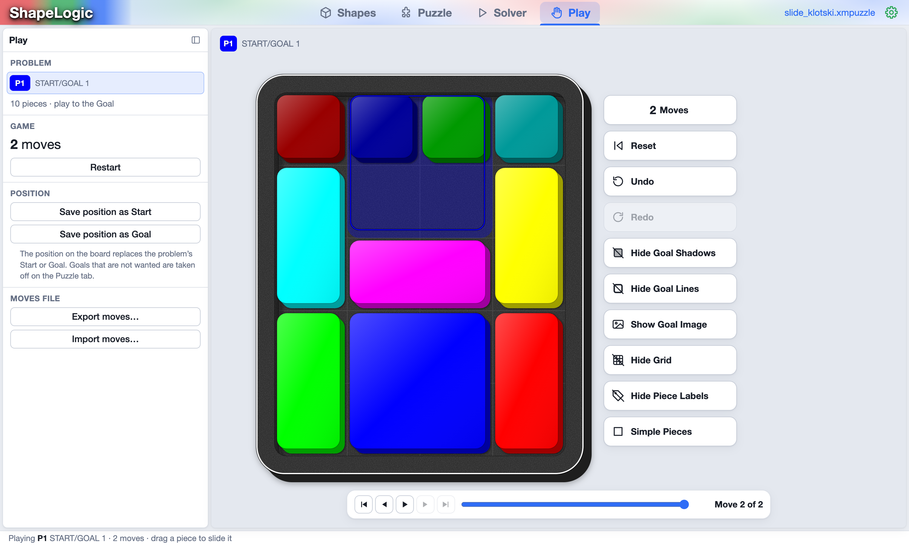
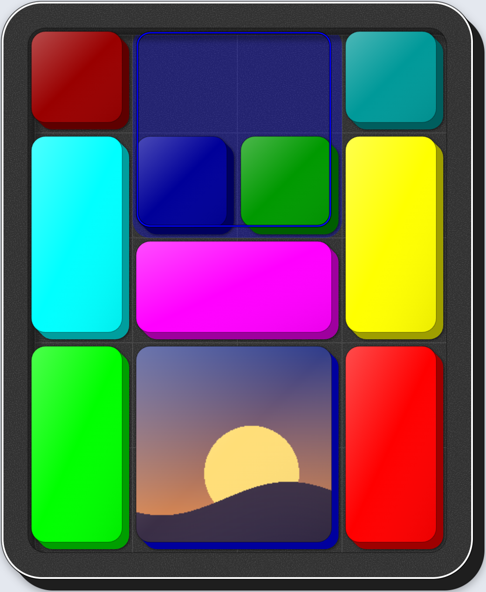
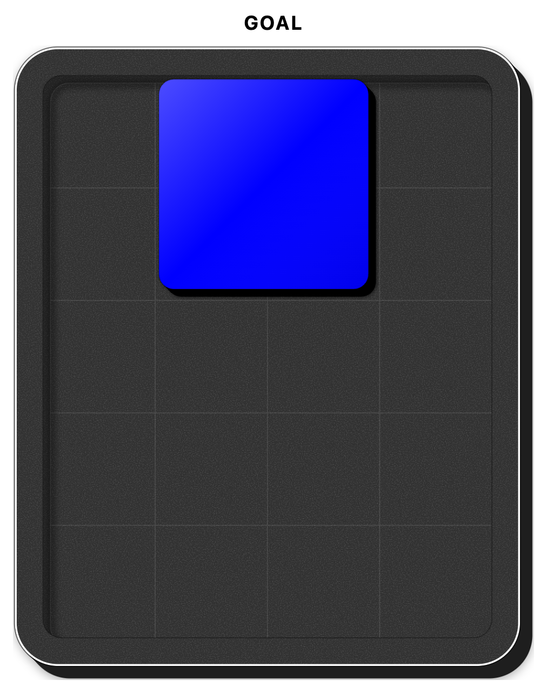
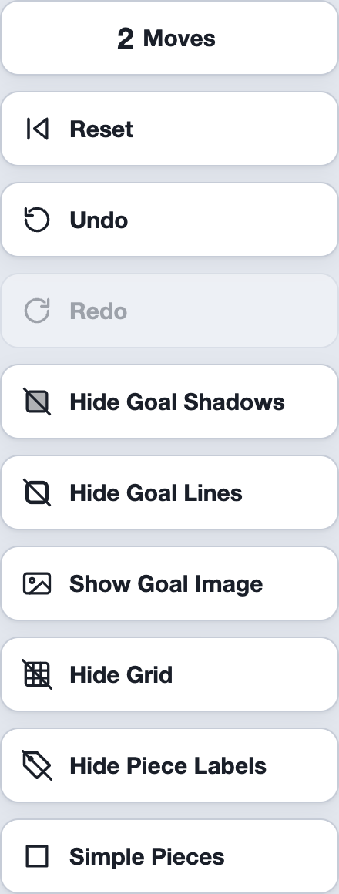
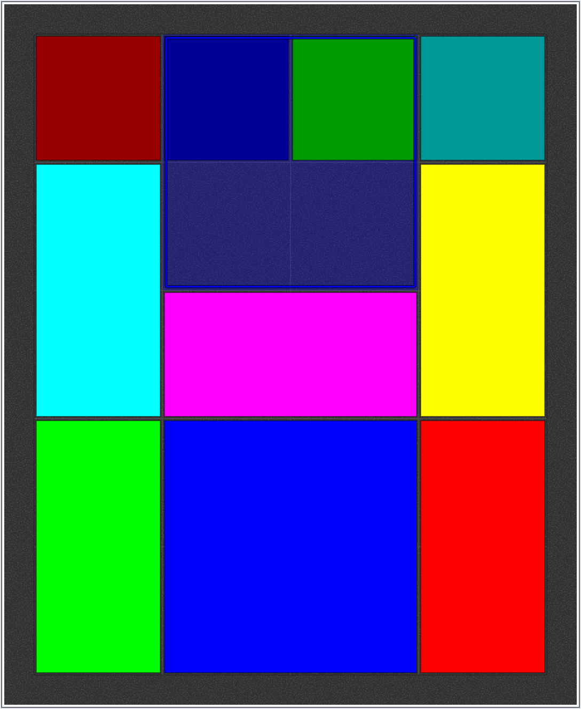
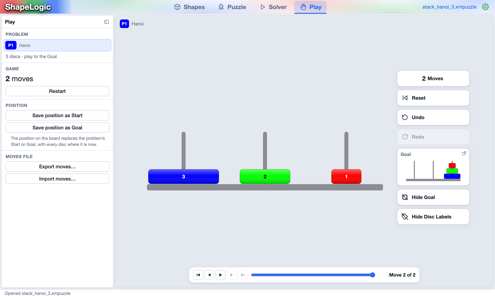
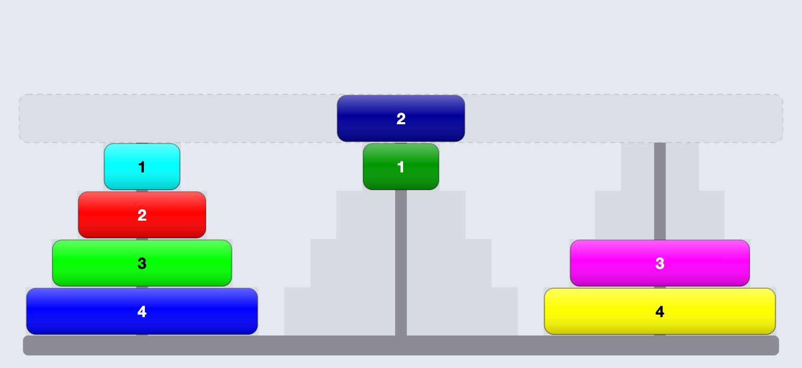
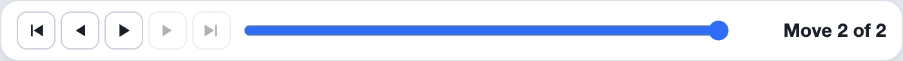
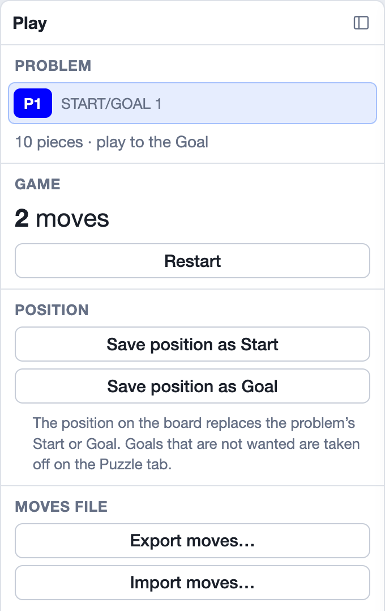

The **Play** tab (`Ctrl+4`, `⌘4` on a Mac) lets you move the pieces of a
[sliding puzzle](/docs/puzzle-types/sliding/) or the discs of a
[stacking puzzle](/docs/puzzle-types/stacking/) yourself instead of having
the Solver find the answer. The tab appears in the top bar, to the right
of Solver, while a sliding or a stacking puzzle is open.

The problem list and the buttons are on the left; the board is in the
middle. Beside it are the number of moves made, **Reset**, **Undo** and
**Redo**, then the buttons of the kind of puzzle, and the playback bar is
below. For a sliding puzzle those buttons are **Hide Goal Shadows**,
**Hide Goal Lines**, **Show Goal Image**, **Hide Grid**, **Hide Piece
Labels** and **Simple Pieces**; a stacking puzzle has a picture of the
Goal, **Hide Goal** and
**Hide Disc Labels** ([Stacking puzzles](#stacking-puzzles) below).

Most of this page describes a sliding puzzle. Undo, Redo, the playback,
saving a position and the moves file work the same way for both.

## Problem

Click a problem to play it. Its pieces appear on the board where its
**Start** puts them. Its **Goal** tints the cells of the tray's floor where
each piece must end, and outlines them in the piece's colour; the outlines
stay visible when pieces stand on them.

**Hide Goal Shadows** takes the goal's tint off the floor, and **Hide Goal
Lines** takes its outlines off the board; hide both to play without seeing
where the pieces should go. Each button then reads **Show Goal Shadows** or
**Show Goal Lines**, which brings them back. **Hide Grid** does the same for
the lines between the cells on the tray's floor (**Show Grid** brings them
back), and **Hide Piece Labels** for the names written on the pieces
(**Show Piece Labels**). **Simple Pieces** draws the pieces flat and square in plain colours,
in a flat tray with square corners; **3D Pieces** brings back the rounded
pieces with their sides showing. Each choice holds for every problem you
play until you change it.

Pieces and boards that have a picture
([Pictures on sliding pieces and boards](/docs/shapes-tab/#pictures-on-sliding-pieces-and-boards))
show it here too: a piece's picture moves with the piece, and a board's
lies on the tray's floor, under the goal's tint and the pieces. Simple
Pieces keeps the pictures.

**Show Goal Image** opens a picture of the goal in a window of its own,
with **GOAL** written above it: the board with each piece that has a goal
standing on it (pieces without one are left out). Drag the window anywhere
and size it as you like; the picture grows and shrinks with it, and it
stays above the app's window while you play. It follows the problem you
play, takes the app's light or dark theme, and closes with the app's
window. Click the button again to bring it forward.

A problem can be played once every piece has a start. If a piece has none,
the tab says which one and offers **Go to Puzzle**, where the Start and
Goal are placed.

A problem without a Goal can still be played: the moves are counted, and
nothing is ever solved.

## Moving the pieces of a sliding puzzle

Drag a piece with the mouse. It follows the pointer through the free
cells and stops against the walls and the other pieces; it never jumps
over anything. It moves with the pointer from the first pixel, so it can
sit between cells while you drag; let go and it settles into the nearest
cell it can reach, which makes the move.

Moves are counted the way the Solver counts them:

- One piece going anywhere it can reach is **one move**, even round a
  corner.
- Dragging the **same piece again** straight away goes on with that move:
  the count doesn't change.
- Putting the piece back where the move began takes the move off.

So your total can be compared with the fewest moves the
[Solver](/docs/solver-tab/) finds.

When the problem has a Goal and the pieces reach it, the board shows
**Solved!** with the number of moves.

### Nested slides

If the problem's Solver options allow **nested slides**, a piece carries
what is nested in it when it cannot move alone. Hold `Shift` while you
drag to carry the nested pieces even when the piece could move alone.

### Boards with more than one layer

A board with several layers is shown one layer at a time; pick the layer
at the top right of the board. Pieces stay in their layer when played by
hand, even if the problem allows vertical moves.

## Stacking puzzles

The board shows the rods from the front. Each disc is a bar as wide as its
size, with its name on it or, when it has none, its size. A name too long
for its disc is cut to the first letter of each word ("Right 1" shows as
"R 1"), and left off when even that doesn't fit. The **Goal**
picture beside the board shows where the discs must end; click it to open
the Goal larger in a window of its own, with **GOAL** above it, which you
can drag anywhere and size as you like (the small icon at its top right
says so; see **Show Goal Image** above). **Hide Goal** takes the picture away so you can play
without it, and **Hide Disc Labels** takes the names and sizes off the
discs.

Only the top disc of a rod moves. To move it, either:

- **drag** it to another rod and let go, or
- **click** its rod (the disc lifts), then click the rod it should go to.
  Click its own rod again to put it down.

You can press anywhere in a rod's column; you don't have to hit the disc.
While you hold a disc, the rods it may go to are highlighted. If the rules
don't allow a move, the disc goes back and the status bar says why, for
example *A larger disc cannot sit on a smaller one.*

Every transfer is **one move**, the way the Solver counts them, so your
total can be compared with the fewest moves the Solver finds. Putting a
disc straight back on the rod it came from takes the move off.

A problem can be played once every disc is on a rod of its **Start** and
the Start follows the rod set's rules. If not, the tab says what is wrong
and offers **Go to Puzzle**. A problem whose Goal is empty can still be
played; if the Goal has discs but isn't complete, the note under the move
count says why it isn't used.

### Panex boards

On a rod set with **Panex Style Columns**, each column has steps behind
it: a disc rests on the step that matches its size, or on the disc below
it. The band across the top is the bridge. One disc more than a column
holds can wait there, raised, and while it does it blocks every move that
would pass over it.

With **Extra outside channel** on, a loop over the bridge joins the first
and last columns: a move between those two goes round the outside, so a
raised disc in between doesn't block it.

## Undo, Redo and playback

**Reset** puts the pieces back at the Start, as ⏮ does: the moves are
kept, so **Redo** makes them again, until you make a new move.
**Undo** takes the last move back and **Redo** makes it again
(`Ctrl+Z` and `Shift+Ctrl+Z`). On this tab these keys act on your moves,
not on edits to the puzzle. Making a new move after an Undo drops the
moves that were undone.

The bar under the board plays your moves back:

| Button | Does |
|---|---|
| ⏮ / ⏭ | Back to the Start / to the last move (`Shift+←` / `Shift+→`) |
| ◀ / ▶ | One move back / forward (`←` / `→`) |
| Play | Plays the moves from where the board is (`Space`; `Esc` pauses) |
| Slider | Goes to any move |

**Restart** throws the moves away and puts the pieces back at the Start.

## Save position as Start or Goal

**Save position as Start** makes the position on the board the problem's
Start: every piece starts where it is now. The game then begins again from
that position.

**Save position as Goal** makes it the problem's Goal: every piece must
end where it is now. To leave some pieces free, take their goals off on
the [Puzzle tab](/docs/puzzle-tab/). (A stacking puzzle's Goal always
places every disc.)

Either one replaces what the problem had, and removes the solutions the
Solver found for it; ShapeLogic asks first when there is something to
lose. It is one undo step: use **Edit ▸ Undo** on another tab to take it
back. Pause a running solve before saving a position.

## Export and import moves

**Export moves…** writes your moves to a `.slmoves` file. Someone else
with the same puzzle can open it with **Import moves…** to watch or
continue your game.

A moves file is taken only by a problem with the same board and the same
Start; for a stacking puzzle that means the same rods and the same discs
on each rod. If one of its moves can't be made, ShapeLogic says which move
and why, and nothing changes. After an import the board is at the Start:
press **Play** to watch the moves.

A sliding puzzle's moves file can't be read by a stacking puzzle, or the
other way round; ShapeLogic says which kind the file is for.

Your moves are not saved in the puzzle file. Export them to keep them.
