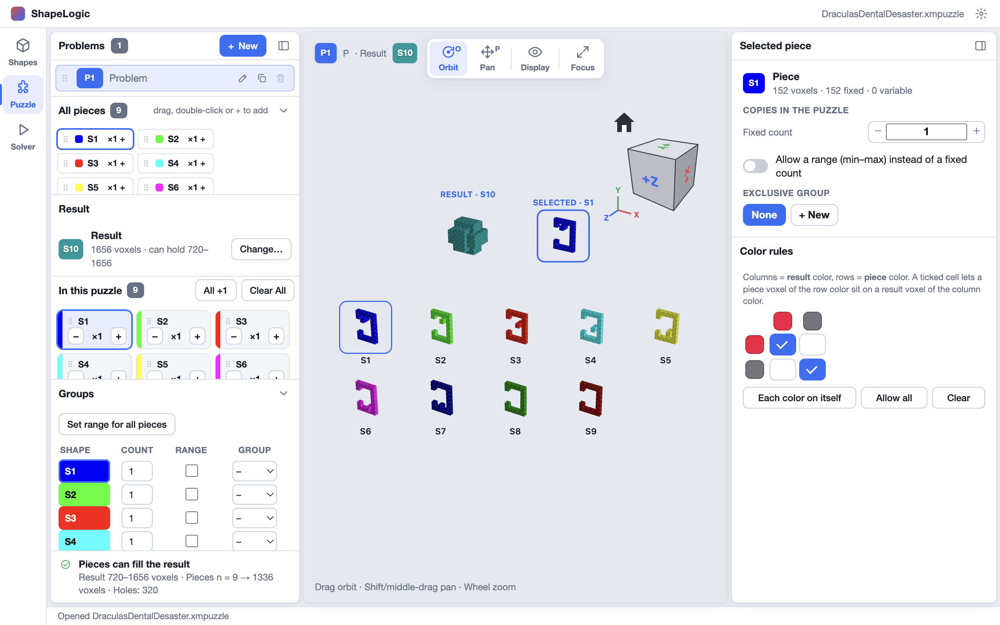
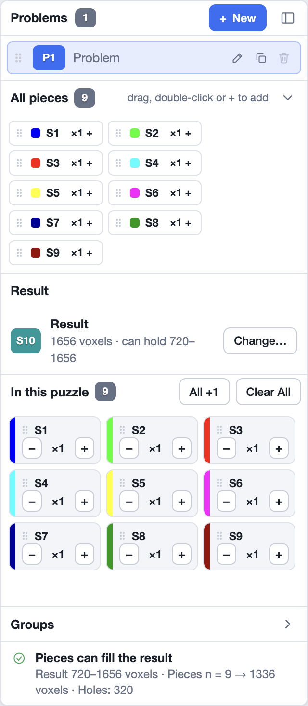
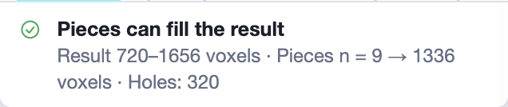
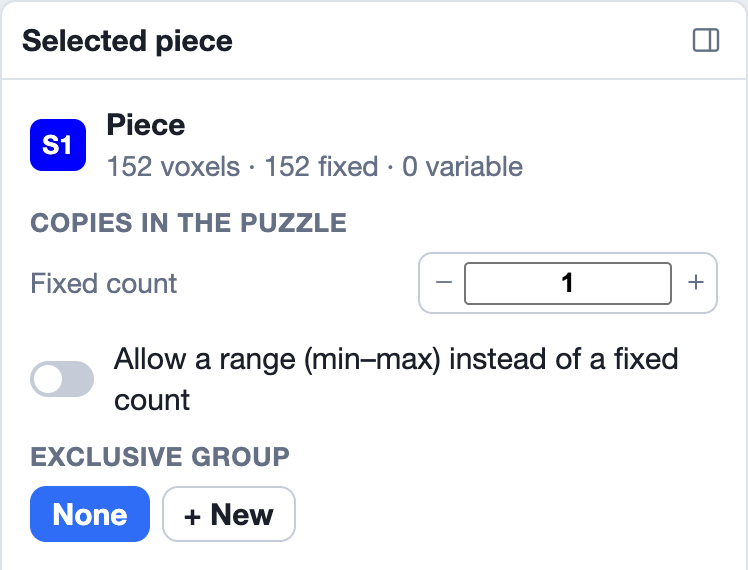
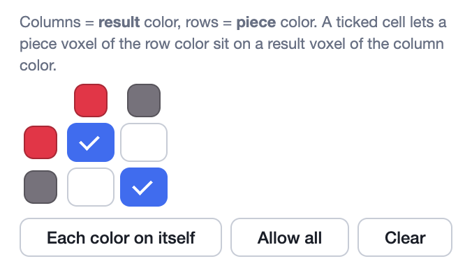

The **Puzzle** tab (`Ctrl+2`, `⌘2` on a Mac) turns shapes into a puzzle to
solve. Here you say which shape is the **result**, which shapes are the
**pieces**, and how many copies of each piece the puzzle uses.

The 3D view shows the result at the top and each piece below it, in as many
columns as fit the view best. The pieces are drawn to scale with each other;
the result is drawn at its own size, so the pieces stay large even when the
result is much bigger than they are. Zooming makes every piece larger or
smaller where it stands. Click a piece in the view to select it.

## Problems

A **problem** is one question for the solver: these pieces, in these
numbers, into this result. A puzzle file can hold several problems that share
the same shapes, for example the same pieces packed into different boxes.

- **+ New** adds a problem. The problems are named **P1**, **P2** and so on.
- Click a problem to edit it. The **Solver** tab solves the problem you pick
  there.
- The selected problem's row has **Rename**, **Duplicate** and **Delete**
  buttons. Drag a row by its grip to reorder the problems.

## All pieces

Every shape in the puzzle, as a chip with its count in this problem. To add
a copy to the problem, **double-click** the chip, click its **+**, or
**drag** it into **In this puzzle**. Click the header to hide or show the
list.

## Result

The shape the pieces must fill. The line under its name gives its size: for
example **1656 voxels · can hold 720–1656** means the result has 720 fixed
voxels that must be filled and 1656 voxels in all, counting the variable ones
that may stay empty.

**Change…** picks another shape as the result. **Set as result** in a
piece's right-click menu does the same.

## In this puzzle

The pieces this problem uses, as tiles:

- **−** and **+** change the number of copies. At 0 the piece leaves the
  puzzle. With a piece selected, the `+` and `−` keys do the same.
- **All +1** adds one copy of every shape that isn't in the puzzle yet.
- **Clear All** takes every piece out.
- Drag a tile out of the card to remove it, or press `Del` with it selected.
- A tile whose shape has a weight other than 1 shows it at the bottom, such
  as **Weight: 2** (see [Piece Weights](/docs/piece-weights/)).
- Right-click a tile for **Move earlier**, **Move later**, one more, one
  fewer, **Remove from puzzle** and **Set as result**.

## Groups

The **Groups** section lists every piece in a table:

- **Count**: the number of copies.
- **Range**: tick it to give a **minimum** and **maximum** instead of a fixed
  count. The solver then tries every count in the range. Use it for puzzles
  like "make this shape from any of these pieces".
- **Group**: puts the piece in a numbered group.
- **Weight**: **W−** and **W+** make the shape lighter or heavier. When a
  disassembly splits the pieces into two groups, the heavier group stays in
  place and the lighter one moves. See [Piece Weights](/docs/piece-weights/).
- **Set range for all pieces** gives every piece the same minimum and
  maximum.

**What groups do.** Normally a disassembly is complete only when every piece
is apart from every other. Pieces in the same group may stay together: the
disassembly counts as complete when only groups are left. Use groups for
pieces that are glued together in the real puzzle, or for a box whose lid
doesn't need to come off.

## The fit check

At the bottom of the card, ShapeLogic checks the voxel counts before you
solve. In the example the pieces fill **1336** voxels and the result has
**720 to 1656**, so the pieces can fill it with **320** variable voxels left
as holes. If the pieces have too many or too few voxels, this line says so,
and there is no point in solving.

## Selected piece

Select a piece (in the lists, or in the 3D view) to see it on the right:

- The piece's label, name and size: its voxels, and how many are fixed and
  variable.
- **Copies in the puzzle**: the **Fixed count** stepper, or with **Allow a
  range (min–max)** on, a minimum and a maximum.
- **Exclusive group**: **None**, an existing group, or **+ New** to make a
  group and put the piece in it. Each group lists its pieces in the
  **Exclusive groups** section below, with a stepper for how many copies are
  in the group and a button to remove the group.

## Color rules

The color rules decide which piece colors may sit on which result colors.
They appear when the puzzle has constraint colors; the colors are added with
the voxel editor's palette on the [Shapes tab](/docs/shapes-tab/#shape-and-restriction-colors).

Columns are **result** colors and rows are **piece** colors. A ticked cell
lets a piece voxel of the row's color sit on a result voxel of the column's
color.

- **Each color on itself** ticks only the diagonal: each color goes only on
  the same color.
- **Allow all** ticks every cell.
- **Clear** unticks every cell.

The Solver's **Strict Color Restrictions** option changes how these rules are
used. [Color Restrictions](/docs/color-restrictions/) explains both.

## Sliding and stacking puzzles

Sliding and stacking puzzles use the Puzzle tab differently: a sliding
puzzle has start and goal positions instead of a result, and a stacking
puzzle has rods and a board. See [Sliding](/docs/puzzle-types/sliding/) and
[Stacking](/docs/puzzle-types/stacking/).
