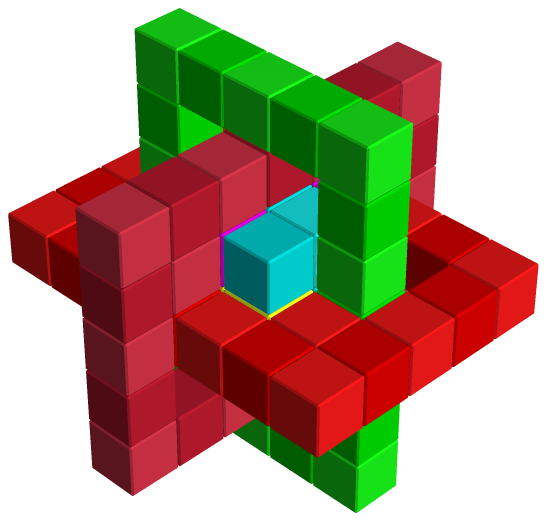

Pieces are made of cubes. This is the usual interlocking burr or packing
puzzle: ShapeLogic finds every way the pieces fill the result shape, then works
out which of those can really be taken apart, and how.

*Cube in Cage by Mineyuki Uyematsu.*

## Building a brick puzzle

Brick is the grid the [Getting started](/docs/getting-started/) tour uses, so
start there for the full workflow. In short:

1. **File ▸ New**, choose **Brick**.
2. On **Shapes**, draw each piece with the **Fixed** and **Variable** tools
   and draw the **result** shape the pieces must fill.
3. On **Puzzle**, choose the result and how many copies of each piece to use.
4. On **Solver**, press **Solve**.

## Cell states

- A **fixed** cell must be filled.
- A **variable** cell may or may not be filled. Use variable cells to leave
  room in a result, or to mark parts of a piece that can be present or absent.
- A piece or result can also be coloured, and **colour constraints** then
  limit which piece cells may sit on which result cells.

## Assembly and disassembly

With **Assemble Only**, the solver reports every way the pieces fit the result.
With **Assemble and Disassemble**, it also checks that each assembly can be
taken apart by moving pieces along the voxel axes. It records the number of
moves, the level of the disassembly, and lets you replay the disassembly in the
**Disassembly player**. Burrs are usually judged by their level: the more
moves needed to take the first piece out, the harder the puzzle.
