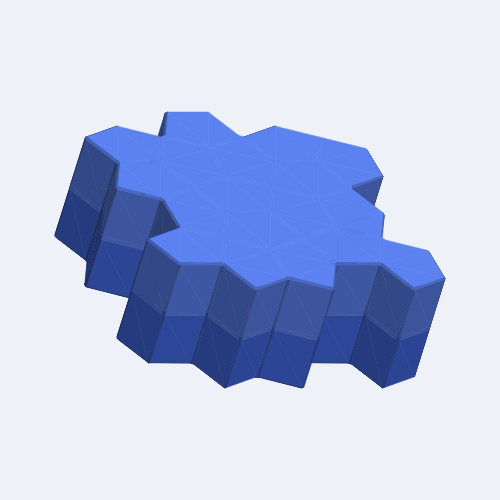

Pieces are made of prisms on the Cairo pentagonal tiling: every cell is a
pentagon with five sides of the same length, and the pentagons lie in four
orientations, meeting four at a time at every other corner and three at a
time at the others. Layers stack on top of one another. This grid is new in
ShapeLogic; BurrTools has no Cairo grid. It suits puzzles cut from the Cairo
tiling, a favourite of puzzle designers for its irregular look.

*Pentagon Slab, an example puzzle: a slab of the tiling in two layers.*

:::caution
This space grid has no disassembler. The solver finds every assembly but cannot
check whether an assembly can be taken apart. The Solver workspace offers
**Assemble Only**; **Assemble and Disassemble** is greyed out.
:::

## How the grid is built

The cells are numbered on a square grid, but only every other coordinate is
a cell: a coordinate (x, y) is a cell when x + y is odd. The four
orientations of the pentagon repeat with a period of four cells along each
axis, so a shape keeps its look when moved by four cells along x or y, by
two cells diagonally, or by any number of layers. The editor's **Nudge**
tools move by exactly these amounts, and **To origin** and **Centre** keep
to them too.

A cell touches five cells of its own layer at its sides, and the cells
directly above and below at its top and bottom; cells that share only a
corner in the tiling touch along the prism's edge.

## On the Shapes workspace

The editor draws each layer as the pentagonal tiling; the coordinates that
are not cells are left blank. The **Rotate** tools turn a shape by 90° about
the vertical axis and over by 180° about the x and y axes; the **Flip** tools
mirror it. **Double ×2** and **Triple ×3** are not offered: a pentagon of
this tiling is not made of smaller ones.

## Drawing and export

The 3D view and the STL export draw this grid with the uniform mesher, so
every style and both the **Uniform bevels** and **Bumpy** switches of the
[STL export](/docs/exports/#stl) work as on the other grids.
