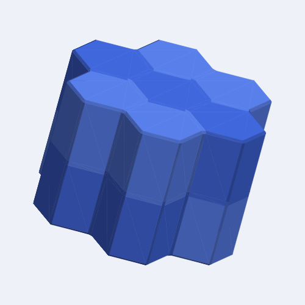

Pieces are made of hexagonal prisms: each layer is a honeycomb of hexagons,
and layers stack on top of one another. This grid is new in ShapeLogic;
BurrTools has no hexagonal grid. It suits puzzles built on a honeycomb, such
as hexagonal packing puzzles and stacked hex-tile puzzles.

*Honeycomb Seven, an example puzzle: a honeycomb of seven cells in two
layers.*

## How the grid is built

A cell is a hexagonal prism, 1 across the flats and 1 high, with its flat
sides to the left and right. The cells of a layer lie in rows along x, and
each row sits half a cell to the right of the row below it. So a shape's
space, which is a box of cells, is a slanted parallelogram on the Shapes
workspace: row 0 at the bottom, each row above it shifted right. Any move by
whole cells, along a row, from row to row or from layer to layer, keeps a
shape's look, so pieces fit anywhere in a result.

A cell touches six cells of its own layer at its sides, and the cells
directly above and below at its top and bottom. It touches the six cells
around the one above, and the six around the one below, along an edge only.
No two cells of this grid touch at a corner alone.

## Taking apart

The disassembler works on this grid: use **Assemble and Disassemble** to find
which assemblies come apart, with their levels and moves, and replay how the
pieces come apart.

Pieces move up and down, across the sides of the hexagons to the next cell
(three directions, each both ways), and along the sides of the hexagons to the
next cell but one (three more). A cell moved across a side passes between the
two cells beside its way, so both must be free or move with it.

## On the Shapes workspace

The editor draws each layer as a honeycomb. The **Nudge** tools move a shape
along its row, up or down a row (which also moves it half a cell sideways),
and up or down a layer. The **Rotate** tools turn a shape by 60° about the
vertical axis and over by 180° about the x and y axes; the **Flip** tools
mirror it. **Double ×2** and **Triple ×3** are not offered: a hexagon is not
made of smaller hexagons.

## Drawing and export

The 3D view and the STL export draw this grid with the uniform mesher, so
every style and both the **Uniform bevels** and **Bumpy** switches of the
[STL export](/docs/exports/#stl) work as on the other grids.
