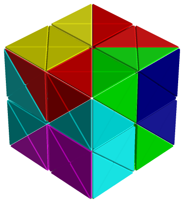

Pieces are made of small tetrahedra cut from cubes, so that they build rhombic
dodecahedra, stellations and other shapes with faces that are not square. The
grid also handles puzzles with diagonally cut cubes, and many puzzles designed
by Stewart Coffin.

*Diagonal Cube by Stewart Coffin.*

:::caution
This space grid has no disassembler. The solver finds every assembly but cannot
check whether an assembly can be taken apart. The Solver workspace offers
**Assemble Only**; **Assemble and Disassemble** is greyed out.
:::

## How the grid is built

The basic cell is a tetrahedron. Cutting a cube along its six 45° diagonal
planes gives 24 identical but irregular tetrahedra, and each of them is one
cell of the grid. A rhombic dodecahedron, the shape most pieces are built
from, is made from a 2×2×2 block of these cubes by cutting away the outer
corners until only a diamond-shaped square rod is left, then repeating for the
other axes.

Stewart Coffin's puzzle books describe pieces with a small set of building
blocks derived from the rhombic dodecahedron: a six-sided centre block, two
prism blocks, a square octahedron, a square pyramid and a tetrahedral block.
Six copies of the centre block are nearly always the centre of a puzzle, and
other blocks are attached to its faces.

## Scale up by 2 when in doubt

The same shape can be built from the tetrahedra in two different ways that look
identical from outside but have different insides. ShapeLogic cannot match one
way against the other, so a puzzle whose pieces and result were built differently
can report no solutions even though they fit.

Scaling all shapes up by 2 makes ShapeLogic build every shape the same way.
When something doesn't work as expected, or to make a final check of a result,
scale every shape up by two (**Fit & scale ▸ Double ×2** on the Shapes
workspace) and check again.
