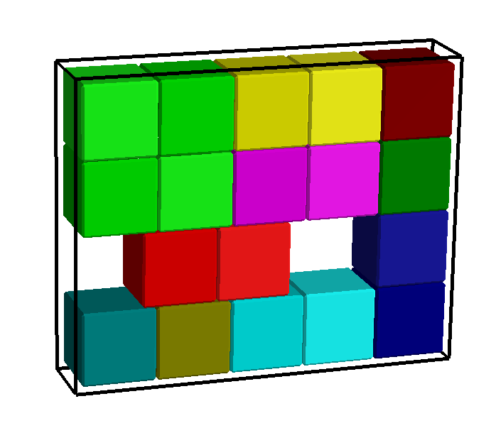
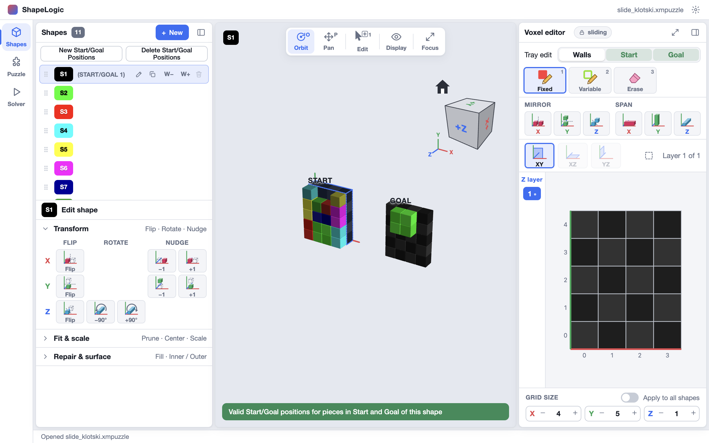
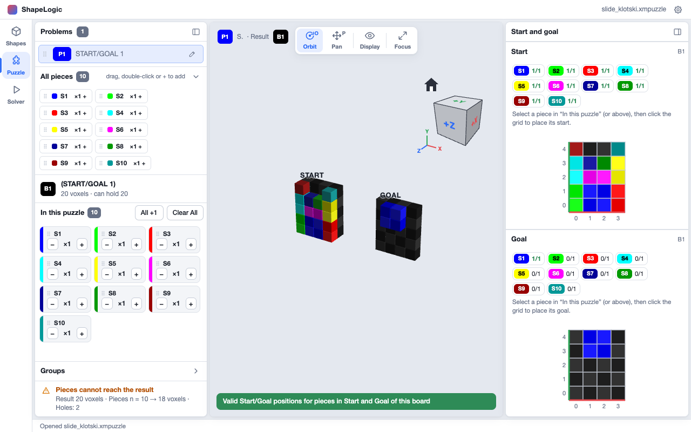
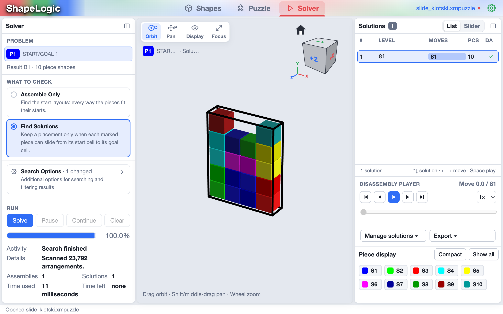

Pieces are flat shapes in a tray. Mark where each piece starts and where it
must end, and the solver finds the fewest moves that slide them from start to
goal, one piece at a time. Pieces can carry others nested inside them when that
is allowed.

*Sliding puzzle by GiiKER Super Slide.*

You can try one now: download [slide_klotski.xmpuzzle](/examples/slide_klotski.xmpuzzle),
a Klotski-style puzzle of ten pieces that the solver finishes in 81 moves.

## How a sliding puzzle is made

A sliding puzzle has two kinds of shape:

- **Pieces** are shapes, usually one layer thick. They are the things that
  slide.
- A **Start/Goal shape**, or **tray**, is a shape that describes the board,
  usually one layer. Its **fixed** cells are floor, its **variable** cells are
  corridors (pieces can cross them but not stop on them) and its **empty**
  cells are walls.

Each piece gets a **start** and a **goal** position, stamped onto a tray: the
whole piece at a time. A piece the puzzle has several copies of gets a start
and a goal for each copy. Trays are also called **boards**. They always stay at
the top of the shapes list and are labelled `B1`, `B2` and so on, while the
pieces below them are `S1`, `S2` and so on. When you delete or move a board,
the boards after it are numbered again, so there is never a gap.

Each board has a problem of its own, named after the board. A board without
a name shows `(Board 1)`. When you rename it, the field starts with
that text, which you can change or delete. The new name also shows in the
**Puzzle** tab's problems list, and renaming the problem there renames the
board. Boards are never pieces: the Puzzle tab's **All pieces** list leaves
them out.

## Shapes: draw the pieces and the board

1. Draw each piece on its own shape, one layer thick unless it needs more.
   **+ New Piece** makes a piece the size of the last piece, or of the
   **Sliding** new shape size if there isn't one yet.
2. Press **+ New Board** above the shapes list to add a board. It takes the
   size of the last board, or the **Sliding** new shape size (6 by 6 by 1
   unless you change it) if there isn't one. Its color follows the theme
   (the **Sliding board color** settings); see
   [Grid editor settings](/docs/shapes-tab/#grid-editor-settings). The
   list's **Delete** removes a board and its problem.
3. Draw the board with the usual tools, as any other shape: **Fixed** is
   floor, **Variable** is corridor and **Erase** is wall.

Sliding puzzles are edited in the XY plane, one layer at a time, and have no
colour constraints.

## Trays with more than one layer

Pieces and trays can have more than one layer: add layers with the **Z**
size stepper. A piece's start or goal covers every cell of the piece in every
layer. To place one, choose a layer beside the Start or Goal grid: the outline under the mouse is
the piece's slice on that layer, and the piece sits as low as it can while
still fitting.

By default every piece stays in its layer: it slides across the tray but
never up or down, even where the layer above is open. Turn on **Allow
Vertical Moves** in the Solver's search options to let pieces move up and
down too. A piece can then be lifted out of a box over the others and put
down somewhere else, as long as the tray has floor cells above for it to
pass through. This counts as one move. Pieces never turn, so a goal that
needs a piece turned around cannot be reached.

## Puzzle: place the starts and goals

On the **Puzzle** workspace the board is the result, and each board has its
own problem, so you do not add or copy problems by hand.

1. Add the pieces to **In this puzzle**, with as many copies of each as the
   puzzle has. Three blue blocks of the same shape are one piece with three
   copies.
2. The right card, **Start and goal**, shows the board twice: **Start** at
   the top and **Goal** below. Above each grid is every piece of the puzzle
   with how many of its copies are placed there, for example `S2 1/3`.
3. Select a piece, in **In this puzzle** or above a grid, then click the
   grid where it goes. It follows the mouse: green where it fits, red where
   it does not, orange on a copy that is already there. A piece with one
   copy moves to where you click. A piece with several copies gets one more
   copy at each click, until all of them are placed. Click a copy, or
   right-click it, to take it off.
4. The 3D view shows two trays side by side, **START** and **GOAL**, at the
   top, and the problem's pieces under them, as on a Brick puzzle; click a
   piece there to select it. A bar at the bottom of the view reads green (*Valid Start/Goal positions…*) or red (*Invalid
   Start/Goal positions - …*, with the reason).

At least one piece needs every copy at a start and at a goal. Any other piece
may have starts and goals for none, some or all of its copies:

- A copy without a start can start anywhere. The solver tries every place it
  fits.
- A copy without a goal can end anywhere.
- Copies of one piece are alike, so any copy may end on any of its goals,
  and swapping two copies' starts does not make a new puzzle.

A piece keeps at least as many copies as are placed at its starts or its
goals: take a copy off first to lower the count.

## Solver: find the shortest slide

For a sliding puzzle, **Find Solutions** is selected by default. It keeps a
start layout only when each marked piece can slide from its start cell to its
goal cell. Press **Solve**: the solver searches breadth first and reports the
fewest moves. The **Solutions** list shows the number of moves, and the
**player** replays them, each piece following its route around corners.

The search options include nested slides and partially nested slides, which
let a piece carry another inside it. **Solve** and **Prepare** stay off while
the start and goal are invalid, with the reason in the button's tooltip.
