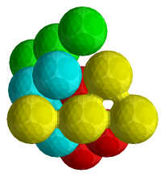

Pieces are made of balls. The balls sit in the tightest packing there is, each
layer resting in the hollows of the one below, as oranges are stacked at a
market. This grid is good for pyramid and ball packing puzzles.

*Ball Room by Stewart Coffin.*

:::caution
This space grid has no disassembler. The solver finds every assembly, every
way the pieces fill the result, but cannot check whether an assembly can be
taken apart, or show how. Untick **Assemble and Disassemble** on the Solver
workspace before solving. The Solutions count then stays empty and the
assemblies are what you get.
:::

## What is different

- **Transforms:** spheres rotate by ±90° about each axis, and the nudge buttons
  work layer by layer. Spheres cannot be scaled.
- **Neighbours:** each ball touches 12 others.

## Keep pieces connected

The sphere grid has one important limitation: it cannot properly handle
pieces made of disconnected groups of balls.

ShapeLogic finds a piece's symmetries from a fixed, finite list of
transformations. In a sphere grid, a piece with separated parts can have
infinitely many symmetries, and only the ones that can occur in a connected
piece are on the list. Some disconnected shapes happen to work, but there is no
guarantee. A piece is *connected* when you can get from every ball to every
other ball by stepping between neighbouring balls. If you want reliable
results, keep every piece, and the result, connected.
