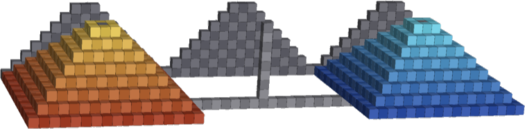
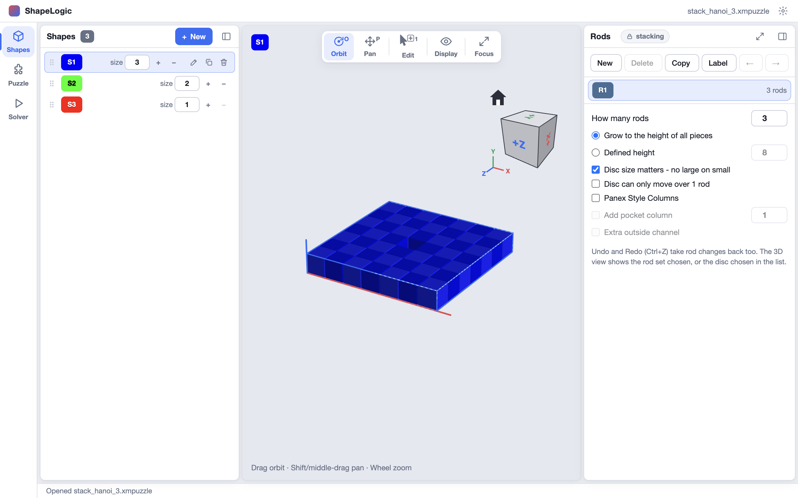
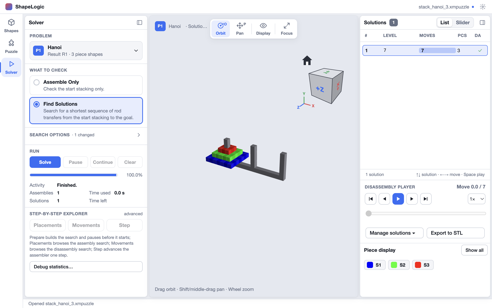

Pieces are discs on vertical rods. A move takes the top disc of one rod and
puts it on another, as in the Tower of Hanoi or Panex. Rules such as *no large
disc on a smaller one* are set for each rod set, and the solver finds the fewest
moves from the start stacks to the goal stacks.

*Panex Level 8 by Toshio Akanuma.*

Download [stack_hanoi_3.xmpuzzle](/examples/stack_hanoi_3.xmpuzzle), a Tower of
Hanoi with three discs, to follow along. The solver finds its 7 moves at once.

## How a stacking puzzle is made

- A **disc** is a shape one cell thick. A disc of *size n* is a square of
  2n+1 by 2n+1 cells with its centre empty, so the rod can pass through it.
- A **rod set** is the board: how many rods, how tall they are and the rules
  of a move.
- A **problem** stands on one rod set and holds the discs of each rod at its
  **start** and at its **goal**.
- A **solution** is the fewest rod transfers from start to goal.

## Shapes: discs and rods

The shapes list holds the discs. Each row has a **size** field (1 to 100) with
**+** and **−**; **New** makes a disc of size 1. Click a disc to see it in the 3D
view.

The right card, **Rods**, edits the rod sets. **New**, **Delete**, **Copy**
and **Label** manage them, and the arrows reorder them. For the selected rod set
you can set:

- **How many rods** (1 to 16).
- The height: **Grow to the height of all pieces**, or a **Defined height**.
- **Disc size matters - no large on small**.
- **Disc can only move over 1 rod**.
- **Panex Style Columns**, with an optional **pocket column** and an **Extra
  outside channel**, for Panex-type puzzles.

Changing a rule removes the solutions of the problems on that rod set, so set
the rules before solving.

## Puzzle: the board and the stacks

On the **Puzzle** workspace, **Set Start/Goal Rods** picks the rod set a
problem uses. The right card, **Stacks**, sets up the discs:

1. Choose **Start** or **Goal**.
2. Pick a rod with the **rod slider**.
3. Add discs with **+1** (the selected disc onto the rod), **All +1** (every
   disc, largest first) and take them off with **−1**. **↑** and **↓** reorder
   discs on the rod, and **Clear All** empties the stacking.

A bar shows **Valid** in green, or **Invalid** in red with the reason, for the
start and goal stackings under the rod set's rules.

## Solver: find the shortest sequence of moves

**Find Solutions** is selected by default: *search for a shortest sequence of rod
transfers from the start stacking to the goal*. Press **Solve**. The solver
type follows the board: the **Panex Solver** for Panex-style columns, the
**Stacking Solver** for everything else. The result is one solution; the player
replays it, each move a lift, a move across and a drop.

Big Panex puzzles can take a long time. The Panex search saves itself every 20
minutes, so **Pause** keeps its progress, and **Continue** carries on later. If a problem has a saved search, **Solve** asks
whether to continue it or start over.
