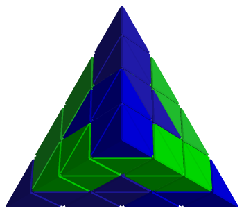

Pieces are made of tetrahedra and octahedra, which together fill space. This
grid is good for pyramid, tetrahedron and octahedron shaped puzzles. A piece
may use both kinds of cell.

*Four Piece Tetrahedron by Wayne Daniel.*

## How the grid is built

Like the [rhombic grid](/docs/puzzle-types/rhombic/), this grid is made purely
of tetrahedra, of two kinds. One cube is made of one regular tetrahedron in the
middle and four irregular tetrahedra around it. Each irregular one has one face
that is an equilateral triangle and three faces that are diagonally cut
squares, and the four together form an octahedron-shaped group.

There are two ways to turn the cube in space, one a rotation of the other, and
the two kinds of cube fill space in a checkerboard pattern.

## Taking apart

The disassembler works on this grid: use **Assemble and Disassemble** to find
which assemblies come apart, with their levels and moves, and replay how the
pieces come apart. BurrTools could only assemble these puzzles, so a file it
solved holds assemblies only: **Manage solutions ▸ Analyse only the missing
disassemblies** works out which of them come apart, without solving again.

Pieces move in nine directions, each both ways: along the diagonals of the
cubes' faces, which are the edges of the tetrahedra and octahedra, one cube at
a time, and along the three axes, two cubes at a time (the cube next door is
turned the other way, so a piece fits the grid again only two cubes on).

## Scale up when in doubt

As with the rhombic grid, some shapes can be built in two ways that ShapeLogic
cannot match. If a solution you expect is missing, scale all shapes up and check
again.
