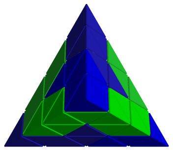

Pieces are made of tetrahedra and octahedra, which together fill space. This
grid is good for pyramid, tetrahedron and octahedron shaped puzzles. A piece
may use both kinds of cell.

*Four Piece Tetrahedron by Wayne Daniel.*

:::caution
This space grid has no disassembler. The solver finds every assembly but cannot
check whether an assembly can be taken apart. Untick **Assemble and
Disassemble** on the Solver workspace before solving.
:::

## How the grid is built

Like the [rhombic grid](/docs/puzzle-types/rhombic/), this grid is made purely
of tetrahedra, of two kinds. One cube is made of one regular tetrahedron in the
middle and four irregular tetrahedra around it. Each irregular one has one face
that is an equilateral triangle and three faces that are diagonally cut
squares, and the four together form an octahedron-shaped group.

There are two ways to turn the cube in space, one a rotation of the other, and
the two kinds of cube fill space in a checkerboard pattern.

## Scale up when in doubt

As with the rhombic grid, some shapes can be built in two ways that ShapeLogic
cannot match. If a solution you expect is missing, scale all shapes up and check
again.
