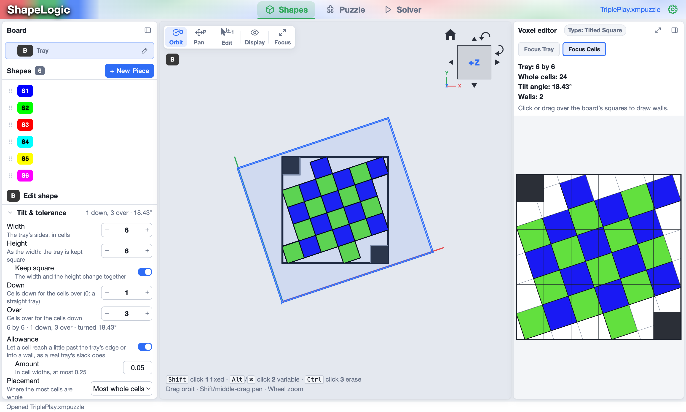
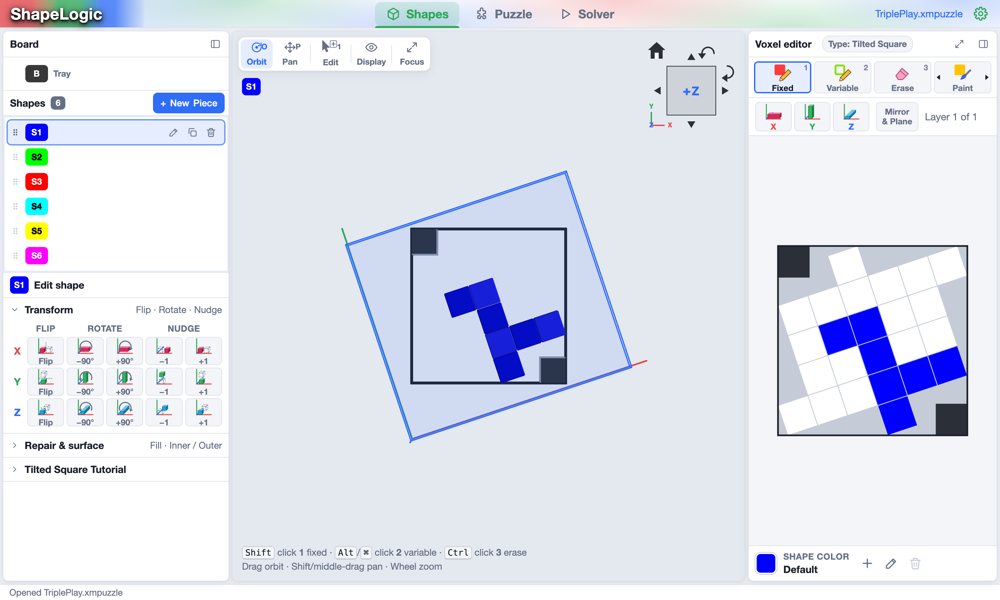
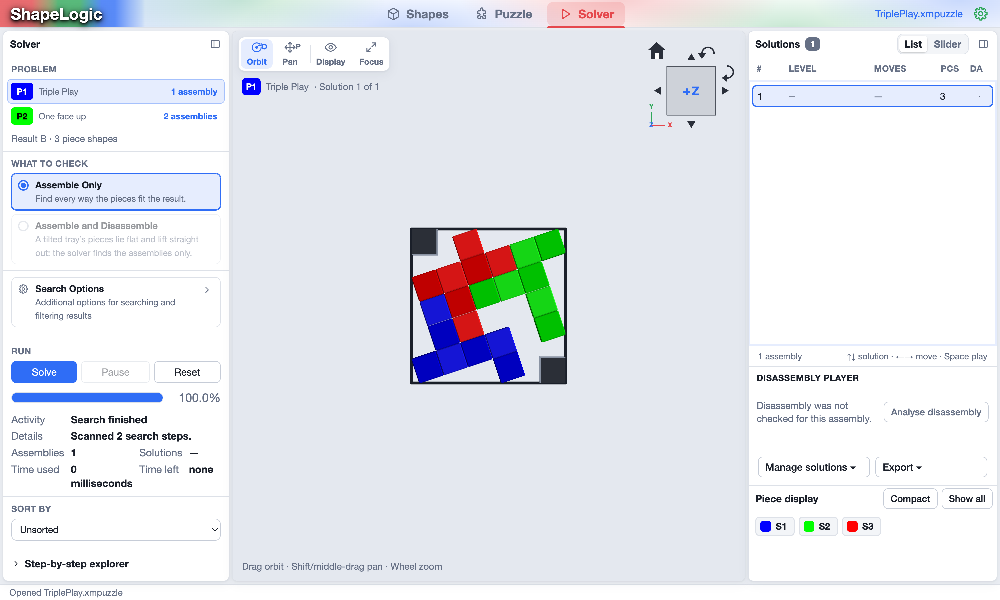
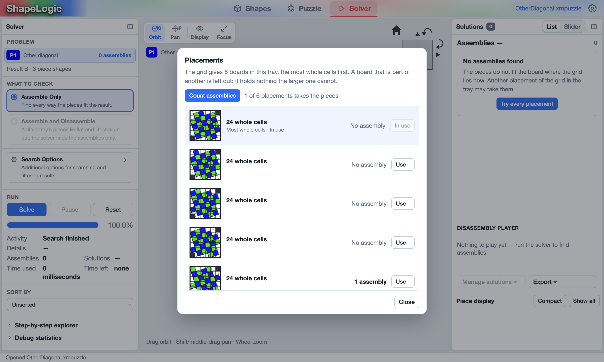

A tray packing puzzle with a twist: the tray is square (or a rectangle), but
the grid of squares inside it is turned. At a slope of **1 down, 3 over** the
grid's rows climb one cell for every three across, about 18.43°. The cells the
tray's edge cuts can hold no piece; the whole cells make the **board**, and the
pieces must fit on it. This kind of puzzle is new in ShapeLogic; BurrTools has
no tray of this kind.

*Triple Play (IPP34) by Goh Pit Khiam and Jerry Loo: three pieces of seven
squares in a 6 by 6 tray with two corners filled. They go in only on a grid
turned 1 down 3 over.*

You can try it now: download [TriplePlay.xmpuzzle](/examples/TriplePlay.xmpuzzle).

## How a tilted puzzle is made

**File ▸ New ▸ Tilted Square** makes a new puzzle with an 8 by 8 tray at 1
down 2 over, strict: 45 whole cells. Change any of it afterwards in **Tilt &
tolerance**.

A tilted puzzle has two kinds of shape:

- **The board** is made for you from the tray. It is always the first shape,
  labeled `B`, in its own **Board** section above the pieces. It cannot be
  copied, deleted or moved, and its cells are never painted by hand: they
  follow from the tray. Every problem's result is the board.
- **Pieces** are drawn on the board's own grid, one layer deep. **+ New
  Piece** makes one; every piece has the board's size.

The pieces must **fit** the board, not fill it: a tray puzzle often leaves
cells empty. Triple Play puts 21 squares of pieces on a board of 24, so three
cells stay empty in its solution.

## Tilt & tolerance

Select the board and the **Tilt & tolerance** section shows the tray's
settings. Each change is one step that **Undo** takes back.

- **Width** and **Height**: the tray's sides, in cells. With **Keep square**
  on, they change together; turn it off for a rectangular tray.
- **Down** and **Over**: the slope. 1 down 2 over turns the grid by 26.57°,
  1 down 3 over by 18.43°. **Down** 0 is a straight tray.
- **Allowance**: a real tray has a little slack, so a cell may reach a
  little past the edge or into a wall. Off, every cell must lie wholly
  inside the tray; on, **Amount** says how far a cell may reach, in cell
  widths (0.05 at first, at most 0.25). A small allowance can add whole rows
  of cells: an 8 by 8 tray at 1 down 2 over holds 45 cells strictly and 52
  with an allowance of 0.05.
- **Placement**: where the turned grid sits in the tray. **Most whole
  cells** puts it where the most cells are whole. **Custom** lets you give
  the shift yourself: where the grid's point (0, 0) lies in the tray, in
  cells.
- **Every placement**: **Placements…** lists every board the grid can give
  in the tray, wherever it lies. See [Every placement](#every-placement)
  below.

When the tray changes, the board is made again and each piece moves by whole
cells to the nearest place where all its cells are whole. A piece that fits
nowhere stays where it was: the status bar names it, and its row in the
shapes list says **Doesn't fit** until it fits again (redraw it on the whole
cells, or change the tray back). The solutions of every problem are dropped,
since they were found on the old board.

The research page [Tilted Square Geometry](/research/tilted-square-geometry.html)
explains how the whole cells are counted and why the placement matters. The
**Tilted Square Tutorial** header below the section opens it too.

## The board's views and walls

With the board selected, the editor on the right shows the tray, its straight
squares over the turned cells. Two buttons set what stands out:

- **Focus Tray** brings out the tray's straight squares.
- **Focus Cells** brings out the turned cells: whole cells in color, cells the
  edge or a wall cuts in gray.

Above the picture, the tray's size, its count of whole cells, its angle and
its walls are listed.

**Walls** belong to the tray, not to the grid. In either view, click or drag
over the tray's squares to make them walls; a drag that starts on a wall opens
squares instead. A drag is one undo step. A wall stays where it is at every
tilt; a cell that overlaps a wall is cut, as one that crosses the edge is (the
allowance counts for walls too). Walls on the rim make trays that are not
plain squares: notched corners, L shapes, crosses.

## Drawing the pieces

A piece's editor shows the tray standing straight with the grid turned inside
it, as the pieces lie in the real tray. Only whole cells take the tools: the
cells the tray cuts are gray and cannot be drawn on. The tray's walls are drawn
dark. The tools are the usual ones (see the
[Shapes tab](/docs/shapes-tab/)), without the size steppers or layers: every
piece has the board's size and one layer. **Transform** turns, flips and
nudges a piece; a change that would leave a cell off the whole cells is
refused.

The 3D view lies as the tray does: the grid turned, the tray's outline and its
walls as dark blocks around the pieces, seen straight down at first.

## Solving

On the **Puzzle** workspace each problem chooses its pieces as usual; the
result is always the board. The **Solver** finds every way the pieces fit:
**Assemble Only**. The pieces lie flat and lift straight out, so there is
nothing to take apart, and the disassembly player says so.

**Pieces may be turned over**, in the Solver's **Search Options**, is on at
first: a piece may be flipped face down, as on the Brick grid. Turn it off for
pieces printed on one side: each piece then keeps its face up and only turns
in the tray's plane. Off, the search has no symmetry filter of its own, so
two assemblies that are the same turned half round may both be listed. The
setting is kept with each problem: Triple Play's second problem, **One face
up**, has it off and uses the mirror images of two of the pieces.

## Every placement

In a real tray the pieces may sit anywhere, so the grid may lie anywhere too.
The placement with the most whole cells is not always one the pieces fit: put
Triple Play's two corner walls on the other diagonal, and its pieces no longer
go where the most cells are whole, yet they do go on another board with as
many cells.

**Placements…** in **Tilt & tolerance** lists every board worth trying, the
most whole cells first, each with its picture and its count of whole cells.
Each board is listed once: boards that are the same moved by whole cells or
turned a quarter are one, and a board that is part of another is left out,
since the pieces need only fit and it holds nothing the larger one cannot.

- **Count assemblies** solves a problem on each board in turn and writes
  the number of assemblies in its row. **Pieces of** chooses the problem
  when the puzzle has several. Nothing in the puzzle is changed, and
  **Stop** ends the count early, keeping what was counted.
- **Use** on a row puts the grid at that placement: one step that **Undo**
  takes back. The first board is the **Most whole cells** placement; any
  other becomes a **Custom** one.

When a solve of a tilted problem ends with no assembly, the Solver offers
**Try every placement**: it opens the same list and counts at once, with the
Solver's options.

A very large tray at a steep slope with many walls can give more boards than
can be looked at; the dialog then says its list is not complete.

:::tip
If no placement takes the pieces, try an allowance: a small one can add whole
rows of cells.
:::

## The file

A tilted puzzle is saved as a Brick puzzle file with the tray's settings and
walls added. BurrTools does not know trays. The
[command line](/docs/command-line/) solves each problem as its **Pieces may
be turned over** setting says; [`--flip on` or `off`](/docs/command-line/#--flip-tilted-square-pieces-turned-over-or-not)
goes over it.
