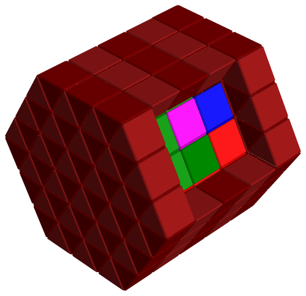

Like [Brick](/docs/puzzle-types/brick/), with a different cell. Each cell is a
prism with a triangular base, and the cells of a layer are triangles, half
pointing up and half pointing down. Layers stack on top of one another. Pieces
are found, and taken apart, as for Brick.

*Prisgon by Markus Götz.*

## What is different

- **Plane:** the layer editor works in the **XY** plane only. Each layer is a
  grid of triangles, and you draw on the triangles directly.
- **Transforms:** flipping, rotating and nudging use the moves that suit the
  cell. A shape can be flipped, rotated by 180° about X or Y, rotated by ±60°
  about Z, and nudged within the plane and up and down along Z. A transform
  that would push a piece out of the grid is blocked, with a message.
- **Solving:** the disassembler works, so you can use **Assemble and
  Disassemble** and replay how the pieces come apart.
