The **Shapes** tab (`Ctrl+1`, `⌘1` on a Mac) is where you draw the pieces and
the result. It has three parts:

- the **Shapes** list and the **Edit shape** tools on the left;
- the [3D view](/docs/viewer/) in the middle;
- the **Voxel editor** on the right.

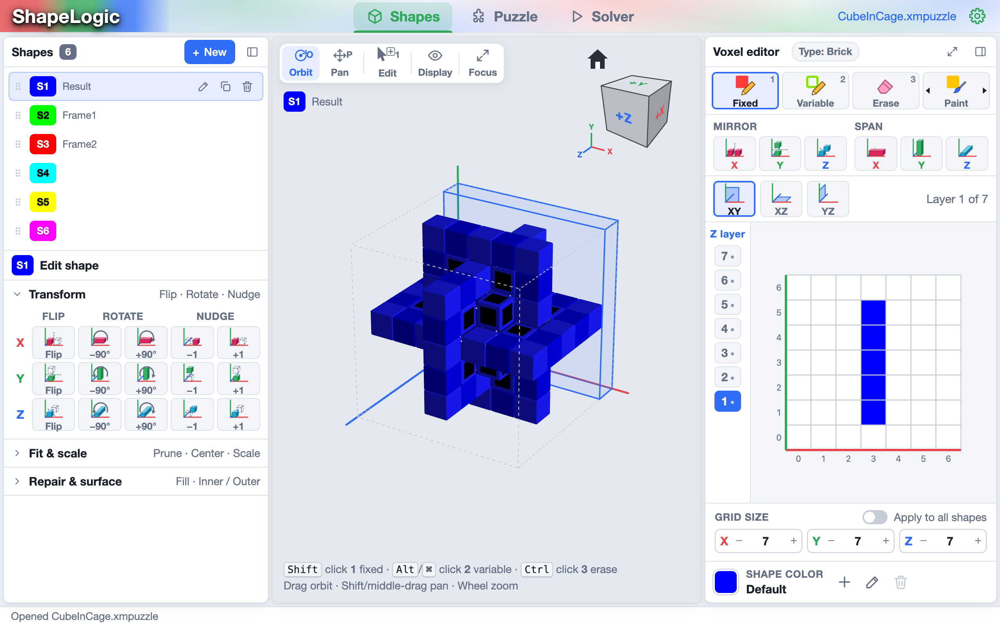

A **shape** is a block of voxels (cells). A shape can be a piece of the
puzzle or the result the pieces must fill. The [Puzzle tab](/docs/puzzle-tab/)
decides which is which. Every voxel is one of two kinds:

- **Fixed** (solid): in the result, a piece must fill it.
- **Variable** (optional): in the result, a piece may fill it or it may stay
  empty. Use variable voxels when you don't know the exact final shape, or
  when the puzzle allows gaps.

## The Shapes list

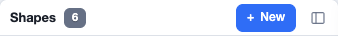

The list holds every shape in the puzzle, named **S1**, **S2** and so on, with
an optional name after the label. Click a shape to select it: the 3D view and
the voxel editor show it, and **Edit shape** works on it.

- **+ New** adds an empty shape, the same size (X, Y and Z) as the selected
  shape. With no shape selected it uses the **New shape size** setting
  ([Settings ▸ Grid editor](#grid-editor-settings)).
- The panel icon at the top right collapses the card to a narrow strip
  (`Ctrl+[`). The strip still shows each shape's chip, so you can switch
  shapes.

The selected row has buttons of its own:

| Button | What it does |
|---|---|
| Pencil (**Rename**) | Gives the shape a name. `F2`, `Enter` or a double-click does the same. |
| Two squares (**Duplicate**) | Adds a copy of the shape at the end of the list (`Ctrl+D`). |
| Bin (**Delete**) | Deletes the shape (`Del`). |

Drag a row by its grip (the dots on the left) to reorder the list. The shapes
are numbered again to follow the new order. `Alt+↑` and `Alt+↓` move the
selected shape up or down.

Right-click a row for the **shape menu**, which has the same actions plus the
shape's color:

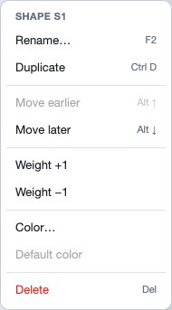

- **Color…** sets the color the shape is drawn in.
- **Default color** goes back to the color ShapeLogic picked for it.

## Voxel editor

The voxel editor draws the selected shape one layer at a time.

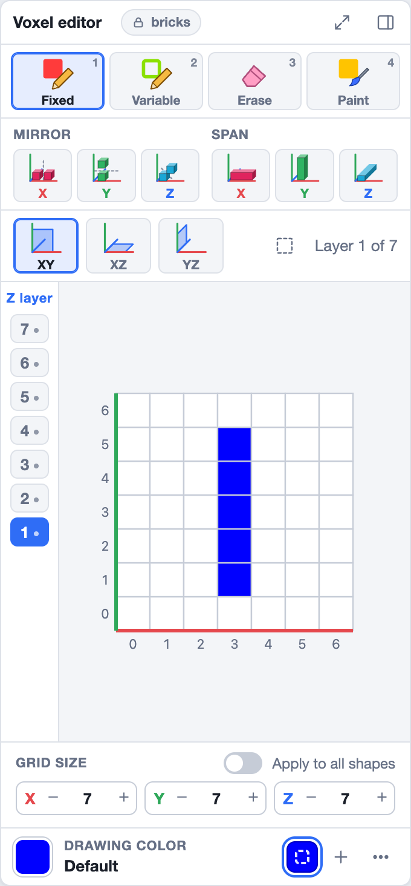

The chip beside the title (**bricks** here) names the puzzle's grid. It has a
lock because the grid is chosen once, when the puzzle is made. The two buttons
at the top right are **Focus 2D editor**, which enlarges the editor (`Esc`
goes back), and **Collapse sidebar** (`Ctrl+]`).

### Tools

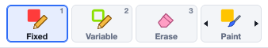

| Tool | Key | What a click does |
|---|---|---|
| **Fixed** | `1` | Places a fixed (solid) voxel. |
| **Variable** | `2` | Places a variable (optional) voxel. |
| **Erase** | `3` | Removes the voxel. |
| **Paint** | `4` | Gives an existing voxel the current **restriction color**, without changing whether it is fixed or variable. Its paintbrush is beside the trash can in the [color area](#shape-and-restriction-colors), and shows only while a restriction color is chosen. |

One of Fixed, Variable and Erase is always chosen. The last button,
**Select**, switches to [box selection](#planes-box-selection-and-layers),
which works with the chosen tool. While you select, the button reads
**Paint** with a paintbrush: click it to go back to drawing with the tools.

Drag across the grid to apply the tool to every cell you pass over. The whole
drag is one undo step. A right-click or right-drag always erases, whatever
tool is active.

You can use a tool for one click without switching to it. Hold `Shift` while
clicking for fixed, `Alt` (`Option` or `⌘` on a Mac) for variable, and `Ctrl`
for erase.

### Mirror and Span

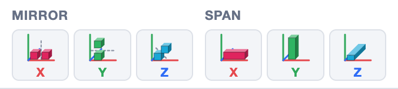

- **Mirror X / Y / Z**: every voxel you place or erase is also placed or
  erased at its mirror image across the middle of the grid along that axis.
  Turn on several to draw symmetric shapes in one go.
- **Span X / Y / Z**: one click fills the whole row of the grid along that
  axis. For example, with Span Z on, one click draws a rod through every
  layer.

Mirror and span work together, and with the box selection below.

### Planes, box selection and layers

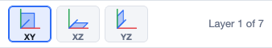

- **XY**, **XZ** and **YZ** choose which slice of the shape the grid shows.
  XY shows layers stacked along Z, XZ layers along Y, and YZ layers along X.
  Each slice is drawn as you would see it from the positive end of its layer
  axis. In XZ, X 0 and Z 0 are at the top left: X counts up to the right and
  Z counts up going down. In YZ the numbers along the bottom run from right
  to left.
  Only the cube-style grids offer all three; the other grids draw in XY. The
  plane a puzzle starts in is the **Grid plane** setting
  ([Settings ▸ Grid editor](#grid-editor-settings)).
- **Select** in the tool strip turns on **box selection**. Drag a rectangle
  in the grid, then click **Fill** to fill it with the chosen tool: fixed or
  variable voxels in the drawing color, or, with Erase chosen, nothing (the
  same as **Clear**). **Clear** always empties it. You can change the tool
  while the box stays selected. Mirror and span apply. `Esc` cancels the
  selection, and **Paint** (the same button) goes back to drawing.
- **Layer 1 of 7** tells you which layer the grid shows.

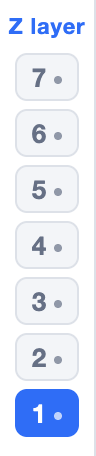

The **layer strip** on the left of the grid has one button per layer. A dot
marks layers that already have voxels. Click a layer to show it, or use
`PgUp` and `PgDn` (`fn+↑` and `fn+↓` on a Mac laptop). The voxels of the
layer below show faintly under the layer you edit, so you can see what you
build on; the **Voxel hint layer** setting
([Settings ▸ Grid editor](#grid-editor-settings)) hints the layer above
instead.

### Grid size

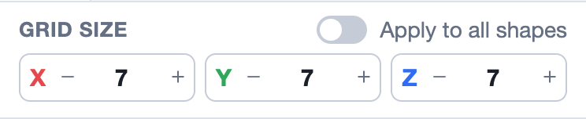

The **X**, **Y** and **Z** steppers make the shape's grid box larger or
smaller. Shrinking a box removes the voxels that no longer fit.

With **Apply to all shapes** on, a size change is applied to every shape:
the others grow by the same amount, but never shrink. The switch also makes
the **Fit & scale** tools work on every shape.

### Shape and restriction colors

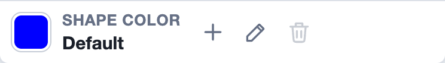

The big swatch shows the color that **Fixed** and **Variable** (and
**Paint**, for a restriction color) draw in (the **drawing color**). Its label says which kind it is:

- **Shape color**: the shape's own color, which means "no restriction".
  Under the label it says **Default** for the color ShapeLogic gives the
  shape, or **Custom** once you have chosen one.
- **Restriction color**: one of the puzzle's constraint colors, **C1**,
  **C2** and so on.

The buttons beside it:

- **+** adds a new restriction color to the puzzle, as different as it can
  be from the colors already there. The palette opens on a second row, with
  the shape's color first and the restriction colors after it.
- The pencil opens a color picker for the current color. For the shape's
  color it has **Restore Default** at the bottom, which goes back from
  **Custom** to **Default**.
- The trash can removes the current restriction color from the puzzle, and
  the color before it in the palette becomes the drawing color. It is off
  while the shape's color is chosen.
- The paintbrush is the **Paint** tool (`4`): a click on an existing voxel
  gives it the restriction color. It shows only while a restriction color
  is chosen; choosing the shape's color goes back to **Fixed**.

Click a swatch in the palette to draw in that color. The palette shows one
row at a time. When a row is full, the next color starts a new row and the
palette moves to it; the small arrows at the right step between the rows.

In the grid, a voxel with a restriction color keeps the shape's color, with
a small box in the restriction color in its top-left corner.

Restriction colors limit where a piece can go; see
[Color Restrictions](/docs/color-restrictions/). Sliding and stacking
puzzles have no restriction colors, so for them the area has only the
shape's color and the pencil.

## Grid editor settings

**Settings ▸ Grid editor** (`Ctrl+,`, or `⌘,` on a Mac) holds the voxel
editor's settings:

- **Grid plane**: the plane the grid starts in, as the **XY**, **XZ** and
  **YZ** buttons above it choose. The grid goes to it when a puzzle is opened
  or made, and when you change the setting; the buttons still switch the
  plane at any time.
- **New shape size**: the X, Y and Z size of a shape made with **+ New** when
  no shape is selected. It has two sets: **Normal Burrs**, used on every grid
  but sliding (4 by 4 by 4 unless you change it), and **Sliding**, used for a
  sliding puzzle's first piece and first board (6 by 6 by 1 unless you change
  it). It counts as the [Grid size](#grid-size) steppers do, so on grids that
  size in blocks it is a number of blocks. With a shape selected, **+ New**
  copies that shape's size instead. On a sliding puzzle, **+ New Piece**
  copies the last piece's size and **+ New Board** the last board's. A
  stacking puzzle's new disc is always size 1.
- **Sliding board color, Light theme** and **Sliding board color, Dark
  theme**: the color of a sliding puzzle's boards in each theme (dark gray
  `#383838` in the Light theme, light gray `#c8c8c8` in the Dark theme). A
  board follows the theme: it changes color when you switch themes. A board
  you give a color of its own, with the pencil beside **Shape color** under
  the voxel editor, keeps that color in both.
- **Voxel hint layer**: the grid shows faintly, in a pale tint of the
  shape's color, where the shape has voxels in a layer next to the one you
  edit. **Hinted layer** chooses which: **Below** (the default) hints the
  layer under it, **Above** the layer over it. In XZ the layers are along Y,
  and in YZ along X. The bottom layer has nothing below it to hint, and the
  top layer nothing above.

## Drawing in the 3D view

You can also draw straight onto the shape in the 3D view:

- Press `E`, or click **Edit** in the 3D view's toolbar, to turn on 3D edit
  mode. A plain click then uses the voxel editor's active tool on the face
  under the mouse. Press `E` again to leave it. While it is on, the bottom
  left corner of the view says what a click does.
- With **Fixed** or **Variable** active, each face of a voxel has three
  parts. A click on its left half adds a voxel beside it. A click on its top
  right quarter makes the voxel fixed or variable, as the tool is (it keeps
  its color; a voxel that already is does not change). A click on its bottom
  right quarter, shown in transparent red, deletes the voxel. The view
  previews what a click would do.
- On a cube grid, a click where there is no face adds a voxel to the voxel
  editor's active layer, so you can start an empty shape in the 3D view.
- Without edit mode, hold `Shift` and click to add a fixed voxel, `Alt` (`⌘`
  on a Mac) to add a variable one, and `Ctrl` to erase. A drag without a
  modifier still turns the view.

## Edit shape

Below the shapes list, **Edit shape** changes the selected shape as a whole.
It has three sections. Click a section's title to open or close it.

### Transform: Flip, Rotate, Nudge

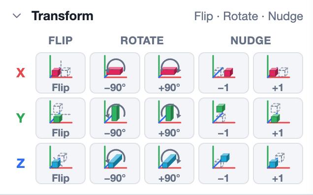

Each row works along one axis, **X**, **Y** or **Z**:

| Button | What it does |
|---|---|
| **Flip** | Mirrors the shape across that axis. A mirrored piece is a different piece unless it is symmetric. |
| **−90°** / **+90°** | Turns the shape a quarter turn clockwise or anticlockwise about that axis. |
| **−1** / **+1** | Nudges the shape one cell along the axis inside its grid box. A nudge that would push voxels out of the box is blocked. |

Hover over a button to see a preview of the result in the 3D view before you
click.

The buttons depend on the grid:

- **Triangular prism** grids turn by **180°** about X and Y and by **60°**
  about Z, and nudge with a pad of arrows **in plane** and along **Z**.
- **Sphere** grids have nudge pads for the **up**, **in** and **down**
  layers.
- **Sliding** puzzles lie flat, so the turns about X and Y and the nudges
  along Z are left out.

### Fit & scale

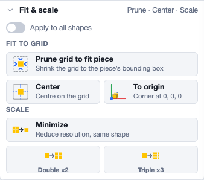

| Button | What it does |
|---|---|
| **Apply to all shapes** | Runs the tools below on every shape at once. |
| **Prune grid to fit piece** | Shrinks the grid box to the shape's bounding box, removing the empty margins. |
| **Center** | Moves the shape to the middle of its grid box. |
| **To origin** | Moves the shape so its corner is at 0, 0, 0. |
| **Minimize** | Reduces the resolution if the shape is made of blocks that are all 2×2×2, 3×3×3 and so on, keeping the same shape with fewer, larger voxels. Cube-style grids only. |
| **Double ×2** | Makes every voxel 2 voxels wide along each axis. Not on sphere grids. |
| **Triple ×3** | Makes every voxel 3 voxels wide along each axis. Not on sphere grids. |

### Repair & surface

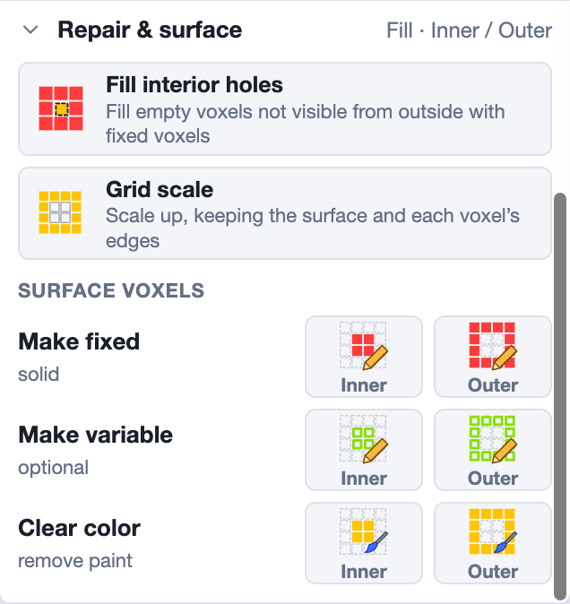

| Button | What it does |
|---|---|
| **Fill interior holes** | Fills every empty voxel that is closed in by the shape and can't be reached from outside, using fixed voxels. |
| **Grid scale** | Scales the shape up, keeping only its surface and the edges of each original voxel, so that the voxels show as a grid. Not on the sphere and tetrahedra-octahedra grids. |
| **Make fixed: Inner / Outer** | Makes the inner voxels (not visible from outside) or the outer voxels (on the surface) fixed. |
| **Make variable: Inner / Outer** | Makes the inner or outer voxels variable. A common use: a result whose surface must be filled but whose inside may have gaps. |
| **Clear color: Inner / Outer** | Removes the constraint color from the inner or outer voxels. |

Every change is one step in the undo history (`Ctrl+Z`), and the status bar
names the step.
