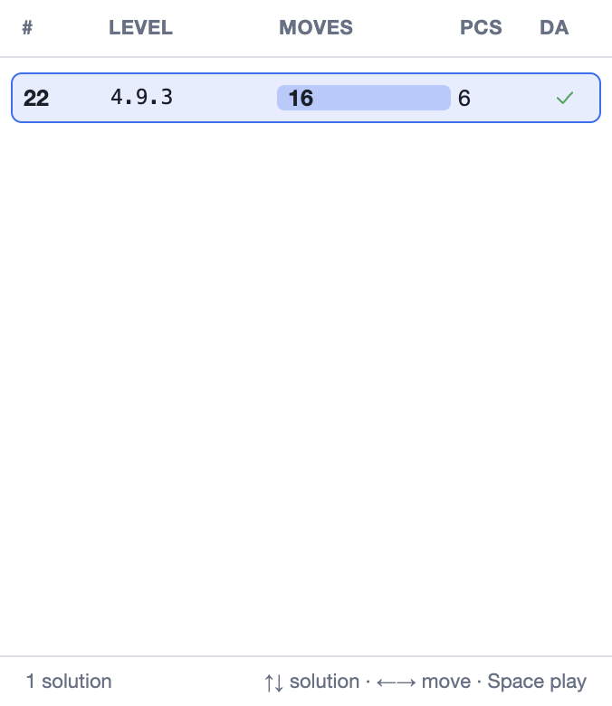

The [Solver tab](/docs/solver-tab/) describes each result with a few numbers
and a dotted code. This page explains them.



## Assemblies and solutions

**Assembly**
: One way the pieces fit together to fill the result. The solver finds them
  all, but leaves out duplicates that are only the same assembly turned
  around or mirrored (unless you ask it to keep them with **Keep Rotated
  Solutions** or **Keep Mirror Solutions**).

**Solution**
: An assembly that can be **taken apart**, and so can also be put together.
  An assembly that is locked solid, with no way to move any piece out, fills
  the result on paper but can't be built.

With **Assemble Only**, the solver stops at assemblies, and the list shows
them all. With **Assemble and Disassemble**, it tries to take each assembly
apart and keeps only the solutions. The Run section counts both:


Here the pieces of CubeInCage fit the result in **96** ways, but only **1**
of those can be taken apart.

## The columns of the list

| Column | Meaning |
|---|---|
| **#** | The assembly number: where this assembly came in the search's order. With several threads the order can change from one run to the next. |
| **Level** | The dotted level code, explained below. |
| **Moves** | The total number of moves to take the puzzle completely apart. |
| **Pcs** | The number of pieces the assembly uses. It matters when pieces have a range of copies. |
| **DA** | Whether the disassembly is stored: ✓ stored, ◐ the level only (with **Just Levels**), × can't be taken apart, · not checked. |

## Moves

A **move** is one step of the take-apart: one piece, or a group of pieces
that stay together, slides along one of the axes. The **Moves** column adds
up every move from the assembled puzzle to all pieces apart.

## Levels

The **level** of a puzzle is the number of moves needed to remove the
**first piece** from the assembled puzzle. It is the usual measure of how
hard an interlocking puzzle is. A level-1 burr has a key piece that slides
straight out. A level-10 burr needs ten moves of several pieces before
anything comes free.

ShapeLogic writes the full level as a dotted code, with one number for each
piece as it comes free:

```
4.9.3
```

Read it left to right:

- **4**: after 4 moves, the first piece comes out.
- **9**: after 9 more moves, the next piece comes out.
- **3**: after 3 more moves, the next piece comes out.

The numbers add up to the total moves: 4 + 9 + 3 = 16, as in the **Moves**
column. The first number alone is the puzzle's level in the usual sense, so
this puzzle is "level 4".

### Fewer numbers than pieces

CubeInCage has 6 pieces but its code has only 3 numbers. A number is written
each time **a single piece** comes free. Two other things don't get a number
of their own:

- **The last two pieces.** When the second-last piece comes out, the last
  piece is left on its own too. That one separation frees both.
- **A split into two groups.** Sometimes the puzzle falls into two parts that
  each still hold several pieces. That split gets no number. Its moves are
  added to the next number, the next single piece that comes free. ShapeLogic
  then takes one group apart, then the other, and writes their numbers one
  after the other.

So a puzzle with *n* pieces has at most *n* − 1 numbers.

### Sorting by level

**Sort by ▸ Level** in the Solver's options, and the **Level** column header
in the list, compare the take-apart step by step from the start. The moves
before the first separation count most, then the moves before the next one,
and so on. So a `4.9.3` puzzle is a higher level than `4.2.8`, and both are
higher than `3.20.1`.

## Levels with rotations

When **Check Rotations** is on and a solution uses at least one rotation,
each number becomes a pair: **slides**, the letter **R**, then **rotations**.


```
3R1.1R1.3R0.2R1
```

- **3R1**: 3 slides and 1 rotation free the first piece.
- **1R1**: 1 slide and 1 rotation free the next piece.
- **3R0**: 3 slides and no rotation free the next piece.
- **2R1**: 2 slides and 1 rotation free the next piece.

Once any rotation is used, every part of the code is written this way, so
`R0` shows where no turn was needed. The **Moves** column gives the totals as
**slides + rotations**: here 3 + 1 + 3 + 2 = **9** slides and
1 + 1 + 0 + 1 = **3** rotations, written `9+3R`.

A solution that needs no rotation is written in plain numbers, as above, even
with Check Rotations on. See [Piece Rotations (TIC)](/docs/piece-rotations/)
for how rotations are found.

## Stacking and sliding puzzles

- A **stacking** puzzle's **Moves** are rod transfers: one disc moved from one
  rod to another.
- A **sliding** puzzle's solutions are the fewest moves from each start to the
  goal.
