The **Solver** tab (`Ctrl+3`, `⌘3` on a Mac) searches for the ways the pieces
fit the result, and plays the solutions back. The options are on the left,
the solution being shown is in the [3D view](/docs/viewer/), and the list of
solutions is on the right.

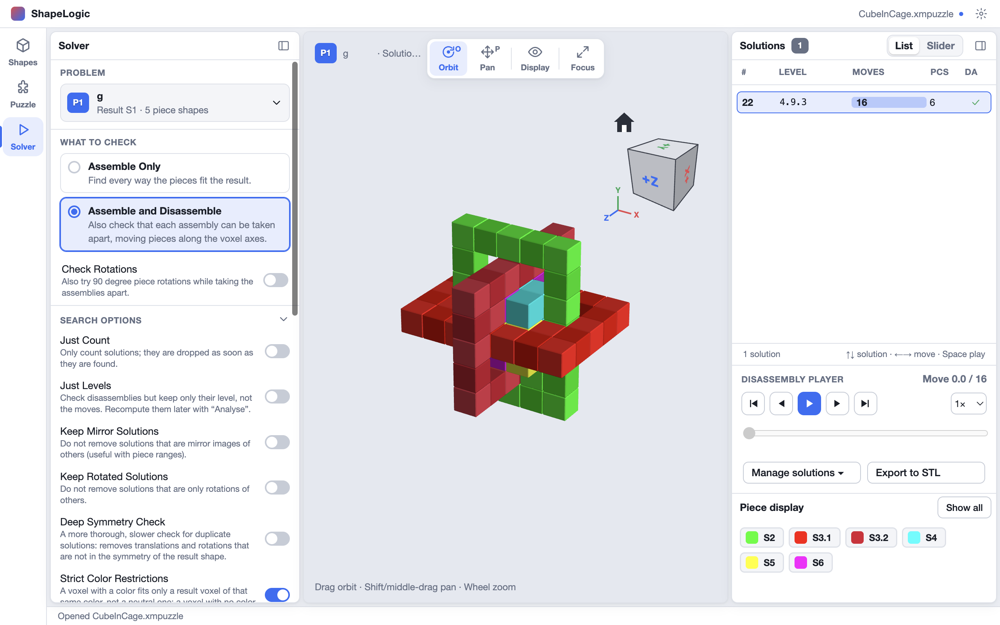

The options are saved with each problem in the puzzle file. A puzzle opened
later is solved the same way.

## Problem

The button at the top shows the problem to solve, its result and how many
piece shapes it uses. Click it to pick another problem. Several problems can
solve at the same time; the picker marks the ones that are **solving** or
**paused**.

## What to check

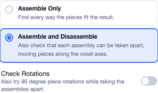

**Assemble Only**
: Finds every way the pieces fit the result (every **assembly**). It doesn't
  check whether the pieces could be put together or taken apart.

**Assemble and Disassemble**
: Also checks that each assembly can be taken apart by sliding pieces along
  the voxel axes. Only assemblies that come apart are kept, as
  **solutions**. Use this for interlocking puzzles such as burrs.

**Check Rotations**
: With **Assemble and Disassemble** only. Also tries turning pieces by 90°
  while taking an assembly apart, for puzzles where a piece must twist to come
  free. It is slower. See [Piece Rotations (TIC)](/docs/piece-rotations/).

[Solve Notation](/docs/solve-notation/) explains assemblies, solutions and
levels.

## Search options

Click **Search options** to open or close the list. When it is closed, the
header says how many options differ from the defaults (for example
**· 2 changed**).

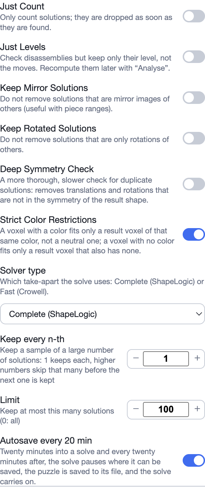

### Just Count

Only counts the solutions. Each one is dropped as soon as it is found, so
nothing appears in the list. Use it to learn how many solutions a puzzle has
without storing them all, which can take a lot of memory. It turns off the
disassembly check and **Just Levels**.

### Just Levels

Checks each assembly's disassembly but keeps only its **level** (such as
`5.2.1`), not the moves. Files stay much smaller. You can work out the moves
of any solution later with **Manage solutions ▸ Analyse this assembly's
disassembly**. Turning it on turns on the disassembly check and turns off
**Check Rotations**.

### Keep Mirror Solutions

Keeps solutions that are mirror images of other solutions. Normally they are
removed as duplicates. Useful with piece ranges, where a mirrored solution
may use different pieces.

### Keep Rotated Solutions

Keeps solutions that are only a rotation of another solution. Normally they
are removed as duplicates. When it is on, **Deep Symmetry Check** and **Keep
Mirror Solutions** don't apply and are greyed out.

### Deep Symmetry Check

A more thorough, slower check for duplicate solutions. It also removes
solutions that differ only by a translation or rotation that is not in the
symmetry of the result shape. Turn it on when the normal check leaves
duplicates. It can't be combined with **Keep Rotated Solutions**.

### Strict Color Restrictions

On by default. A voxel with a color fits only a result voxel of exactly that
color, not a neutral one, and a voxel with no color fits only a result voxel
that also has no color. The color rules of the Puzzle tab are not used. Off,
neutral voxels fit anywhere and the color rules decide the rest. See
[Color Restrictions](/docs/color-restrictions/).

### Solver type

Which take-apart search the solve uses:

- **Complete (ShapeLogic)**: a complete search. It finds every disassembly
  there is, including all rotation moves when **Check Rotations** is on.
- **Fast (Crowell)**: Andrew Crowell's take-apart, which uses shortcuts to
  try fewer rotation moves. Much faster on large puzzles with **Check
  Rotations**, but it can miss some disassemblies.

Both find the same assemblies; only the take-apart differs. See
[Piece Rotations (TIC)](/docs/piece-rotations/#the-two-solver-types).

A problem that has no solver type saved starts with the **Default solver
type** setting (**Settings ▸ Solver**, `Ctrl+,` or `⌘,` on a Mac), Complete
unless you change it. The type you choose here is saved with the problem.

### Keep every n-th

Keeps a sample of a large number of solutions. **1** keeps every solution;
**2** keeps every second one, **10** every tenth, and so on. It applies when
**Sort by** is **Unsorted**. Not saved with the problem.

### Limit

Keeps at most this many solutions. **0** keeps them all. The default is
**100**. The solver goes on counting after the limit, so the **Solutions**
count is still right. Not saved with the problem.

### Autosave every 20 min

On by default. Twenty minutes into a solve and every twenty minutes after,
the solve pauses where it can be saved, the puzzle is saved to its file, and
the solve carries on. If the computer crashes you lose at most twenty
minutes. For a stacking puzzle, the search saves itself instead, and
**Continue** carries it on.

### Options for sliding puzzles

A [sliding puzzle](/docs/puzzle-types/sliding/) shows **Find Solutions** in
place of Assemble and Disassemble, and these options in place of the
symmetry and color ones:

- **Allow Nested Slides**: a piece may slide together with the pieces nested
  inside its outline, such as a piece in another piece's pocket. Pieces that
  only touch never slide together.
- **Allow Partially Nested**: with **Allow Nested Slides** on, a piece may
  also slide together with a piece that sits partly in its outline and sticks
  out of it.
- **Allow Vertical Moves**: on a tray with more than one layer, a piece may
  also move up and down, lifted over the other pieces and put down somewhere
  else. Off (the default), every piece slides only in its own layer.
- **Enable High Memory**: lets the search use up to half of the computer's
  memory, instead of stopping at about 2 GB. On by default.
- **Solver type**: each start is searched for the fewest moves to the goal.
  **Sliding Fast Solver (250k depth)** looks at up to 250,000 arrangements
  per start, **Sliding Deep Solver (1mil depth)** up to 1,000,000, and
  **Sliding Full Solver (full depth)** has no limit: it either finds the
  fewest moves or proves there is no solution, keeping older moves on disk.

### Options for stacking puzzles

A [stacking puzzle](/docs/puzzle-types/stacking/) shows **Find Solutions**
(the fewest rod transfers from the start stacking to the goal) and:

- **Just Count** and **Just Levels**, as above.
- **Enable High Memory**: lets the search use up to half of the computer's
  memory, instead of stopping at about 2 GB. On by default.
- **Solver type**: the **Stacking Solver**, or the **Panex Solver** for rod
  sets with Panex style columns. The board decides which; it can't be
  changed. The Panex Solver searches from both ends on every core, and
  **Pause** saves its search so **Continue** can carry it on, even after
  quitting.

## Run

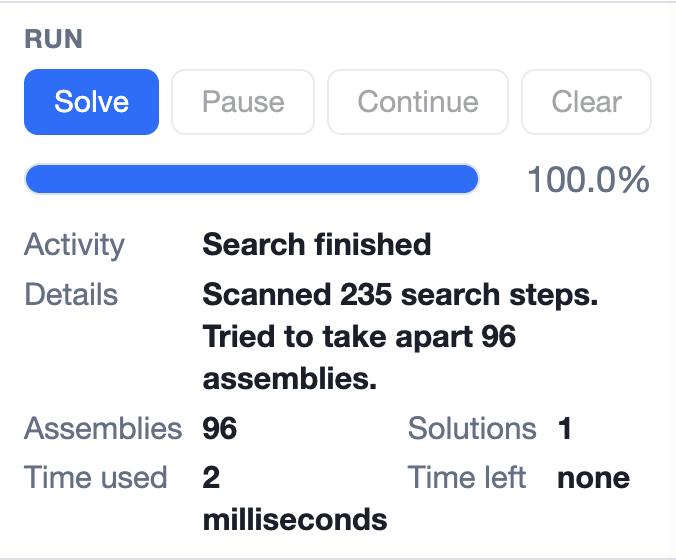

| Button | What it does |
|---|---|
| **Solve** | Runs the search from the start. Old results of this problem are removed. |
| **Pause** | Stops the search where it can be carried on. Save the puzzle to keep the paused search in the file. |
| **Continue** | Carries on a paused search. |
| **Clear** | Stops at once and throws away everything kept of this problem's solve: its results, the paused state and any saved search. |

Below the buttons:

- the **progress bar** and its percentage;
- **Activity**: what the solver is doing now;
- **Assemblies**: how many assemblies have been found;
- **Solutions**: how many of them could be taken apart (with the
  disassembly check);
- **Time used** and an estimate of the **Time left** ("unknown" until the
  solver can tell). Time used counts every run of the solve: Continue
  carries on from the time already used, also after quitting or loading
  a paused solver state.

If a solve fails, the reason appears under the counters.

## Sort by

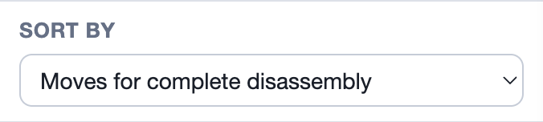

The order the solver keeps the solutions in, as it finds them:

- **Unsorted**: the order they are found.
- **Moves for complete disassembly**: the most moves to take the whole
  puzzle apart first. This is the default.
- **Level**: by [level](/docs/solve-notation/#levels), the highest first.
- **Rotations**: by the number of rotation moves, the most first.

The last three need the disassembly check, and say **(needs disassembly)**
without it. With a **Limit** set, the sort decides which solutions are kept:
the limit keeps the hardest ones found, the ones at the top of the order. You can also sort the list
afterwards by clicking its column headers.

## Step-by-step explorer

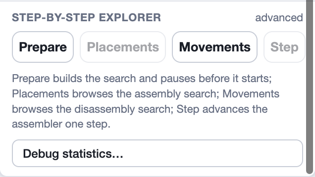

These advanced tools let you look inside a search. They open a drawer below
the 3D view; `Esc` closes it.

- **Prepare** builds the search (every place each piece can go) and pauses
  before the first step, so **Placements** and **Step** have a search to
  show. It removes old results.
- **Placements** browses every position each piece can take in the result.
  Pick a piece, then step or drag through its placements.
- **Movements** browses the disassembly search of the solution shown:
  position by position, which moves are possible. You can analyse a node,
  try your own move, go back to the parent, and prune the tree.
- **Step** advances the assembler by 1, 10, 100 or 1000 steps, or takes it
  back to its start.
- **Debug statistics…** shows the solve's statistics as it runs: how much
  time went into assembling, sliding moves and rotation moves, and where the
  time is going.

## Solutions

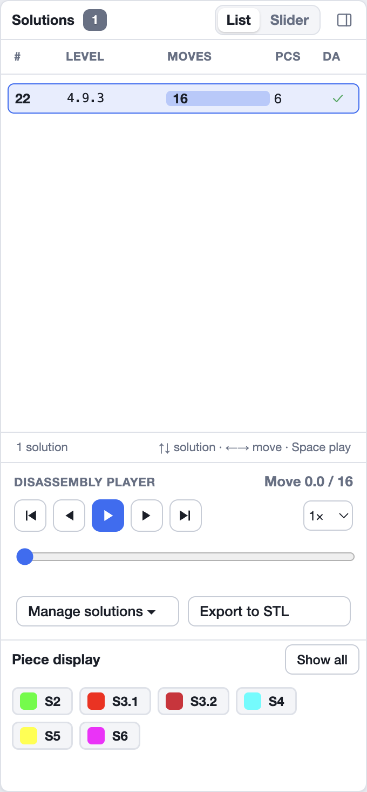

### List and Slider

**List** shows every solution in a table:

| Column | Meaning |
|---|---|
| **#** | The assembly number: the order the search found it. |
| **Level** | The disassembly level, such as `4.9.3`. See [Solve Notation](/docs/solve-notation/). |
| **Moves** | The total moves to take the puzzle apart, with a bar. With rotations, `9+3R` means 9 slides and 3 rotations. |
| **Pcs** | The number of pieces the assembly uses. |
| **DA** | The disassembly status: ✓ stored, ◐ level only (moves not stored), × can't be taken apart, · not checked. |

Click a column header to sort by it, click again to reverse, and a third time
to go back to the saved order. `↑` and `↓` move between solutions.

**Slider** shows one solution at a time, with its numbers in boxes. Drag the
slider or use the arrows to move between solutions.

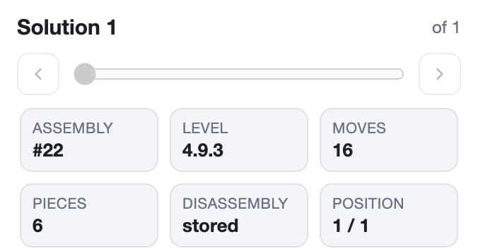

### Disassembly player

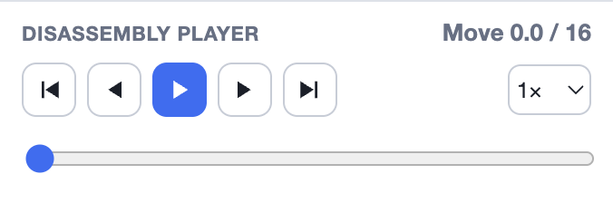

The player animates the selected solution coming apart. The buttons go to
the assembled position, one move back, play or pause, one move forward, and
to fully apart. The menu on the right sets the speed, and the bar below
jumps to any point. Keys: `Space` plays or pauses, `←` and `→` step one move,
`Shift+←` and `Shift+→` jump to assembled or fully apart.

A solution without stored moves shows **Analyse disassembly** instead, to
work its moves out.

### Manage solutions

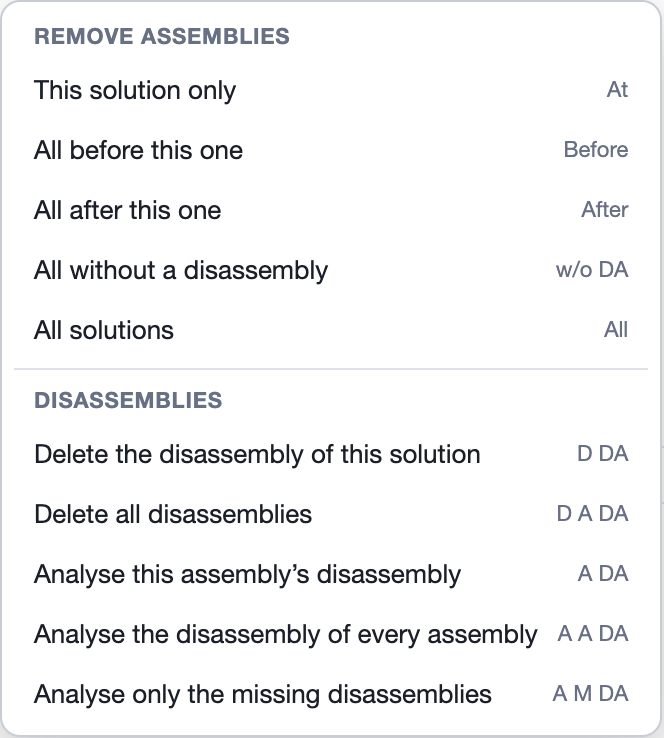

**Remove assemblies**

- **This solution only**: removes the selected solution.
- **All before this one** / **All after this one**: removes every solution
  listed before or after the selected one.
- **All without a disassembly**: removes every solution that has no stored
  disassembly.
- **All solutions**: removes all the solutions of this problem.

**Disassemblies**

- **Delete the disassembly of this solution**: throws away its moves, keeping
  the solution and its level.
- **Delete all disassemblies**: the same for every solution.
- **Analyse this assembly's disassembly**: works out how the selected
  assembly comes apart, and keeps the moves.
- **Analyse the disassembly of every assembly**: works them all out again.
- **Analyse only the missing disassemblies**: only for solutions that have
  none stored.

An analysis shows its progress above the menu, with a **Stop** button. The
analysis uses **Check Rotations** and the **Solver type** as they are set.

**Export to STL** writes each piece the selected solution uses as its own STL
file, for 3D printing. See [Exports](/docs/exports/#export-solution-pieces-to-stl).

### Piece display

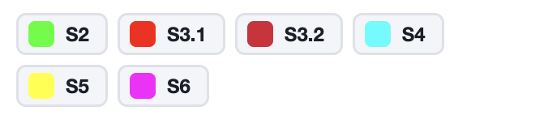

One chip per piece of the solution, showing its label and, if the shape has
a name, the name after it (`S2 - my_label`). Click a chip (or press `Space`
or `Enter` on it) to cycle the piece through **solid**, **wireframe** and
**hidden**, so you can see the pieces inside. **Show all** puts every piece
back to solid. **Compact** shows the labels alone (`S2`); the button then
reads **Full**, which brings the names back. ShapeLogic remembers the
choice.
