The **Solver** tab (`Ctrl+3`, `⌘3` on a Mac) searches for the ways the pieces
fit the result, and plays the solutions back. The options are on the left,
the solution being shown is in the [3D view](/docs/viewer/), and the list of
solutions is on the right.

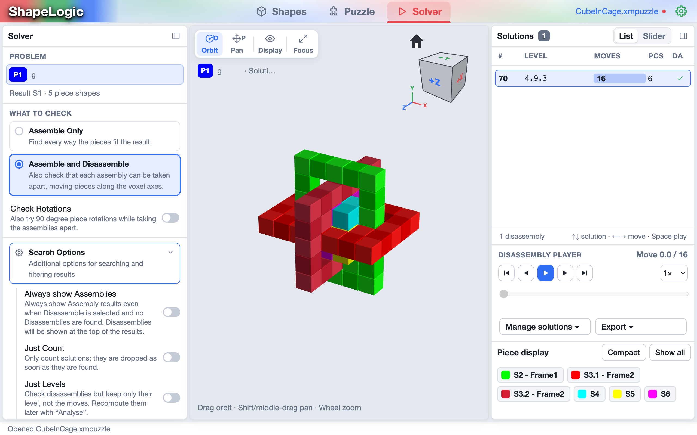

The options are saved with each problem in the puzzle file. A puzzle opened
later is solved the same way.

## Problem

The list at the top shows the puzzle's problems, as on the Puzzle tab. Click
one to solve it; below the list are its result and how many piece shapes it
uses. Several problems can solve at the same time; the list marks the ones
that are **solving**, **pausing** (Pause pressed, the search not yet
stopped) or **paused**.

## What to check

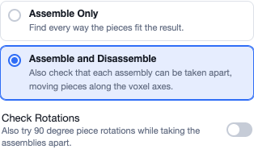

**Assemble Only**
: Finds every way the pieces fit the result (every **assembly**). It doesn't
  check whether the pieces could be put together or taken apart.

**Assemble and Disassemble**
: Also checks that each assembly can be taken apart by sliding pieces along
  the voxel axes. Only assemblies that come apart are kept, as
  **solutions**. Use this for interlocking puzzles such as burrs.

**Check Rotations**
: With **Assemble and Disassemble** only. Also tries turning pieces by 90°
  while taking an assembly apart, for puzzles where a piece must twist to come
  free. It is slower. See [Piece Rotations (TIC)](/docs/piece-rotations/).

[Solve Notation](/docs/solve-notation/) explains assemblies, solutions and
levels.

## Search options

Click **Search options** to open or close the list. When it is closed, the
header says how many options differ from the defaults (for example
**· 2 changed**).

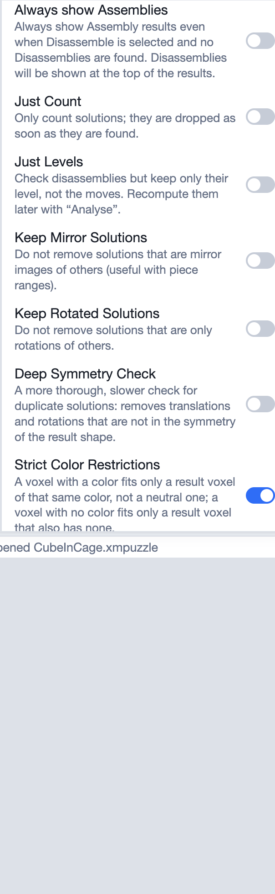

### Live preview

The first switch in the list, **Live preview** (on by default), shows what
the search is doing in the 3D view, a few times a second, while no solution
is chosen. A sliding or stacking puzzle shows the arrangements the search
is looking at. With the disassembly check, the view shows the take-apart
under way: the pieces of the part it is working on, in a position it has
reached. The search for assemblies itself has nothing to show, so an
Assemble Only run still says *Searching…*. Choosing a solution shows that
solution; clearing the choice brings the preview back. The preview costs
the search next to nothing.

Unlike the other search options, it is one setting for every problem and
is not saved with the puzzle, and it can be switched while a solve runs
(open the list to reach it). **Settings ▸ Search Options** has the same
switch. Sphere puzzles, which have no take-apart, do not show it. It is not
in the browser demo, which does not run searches.

### Just Count

Only counts the solutions. Each one is dropped as soon as it is found, so
nothing appears in the list. Use it to learn how many solutions a puzzle has
without storing them all, which can take a lot of memory. It turns off the
disassembly check and **Just Levels**.

### Just Levels

Checks each assembly's disassembly but keeps only its **level** (such as
`5.2.1`), not the moves. Files stay much smaller. You can work out the moves
of any solution later with **Manage solutions ▸ Analyse this assembly's
disassembly**. Turning it on turns on the disassembly check and turns off
**Check Rotations**.

### Keep Mirror Solutions

Keeps solutions that are mirror images of other solutions. Normally they are
removed as duplicates. Useful with piece ranges, where a mirrored solution
may use different pieces.

### Keep Rotated Solutions

Keeps solutions that are only a rotation of another solution. Normally they
are removed as duplicates. When it is on, **Deep Symmetry Check** and **Keep
Mirror Solutions** don't apply and are greyed out.

### Deep Symmetry Check

A more thorough, slower check for duplicate solutions. It also removes
solutions that differ only by a translation or rotation that is not in the
symmetry of the result shape. Turn it on when the normal check leaves
duplicates. It can't be combined with **Keep Rotated Solutions**.

### Strict Color Restrictions

On by default. A voxel with a color fits only a result voxel of exactly that
color, not a neutral one, and a voxel with no color fits only a result voxel
that also has no color. The color rules of the Puzzle tab are not used. Off,
neutral voxels fit anywhere and the color rules decide the rest. Sliding
puzzles don't have this switch: their colors always match as with it off.
See [Color Restrictions](/docs/color-restrictions/).

### Solver type

Which take-apart search the solve uses:

- **Complete (ShapeLogic)**: a complete search. It finds every disassembly
  there is, including all rotation moves when **Check Rotations** is on.
- **Fast (Crowell)**: Andrew Crowell's take-apart, which uses shortcuts to
  try fewer rotation moves. Much faster on large puzzles with **Check
  Rotations**, but it can miss some disassemblies.

Both find the same assemblies; only the take-apart differs. See
[Piece Rotations (TIC)](/docs/piece-rotations/#the-two-solver-types).

A problem that has no solver type saved starts with the **Default solver
type** setting (**Settings ▸ Solver**, `Ctrl+,` or `⌘,` on a Mac), Complete
unless you change it. The type you choose here is saved with the problem.

### Keep every n-th

Keeps a sample of a large number of solutions. **1** keeps every solution;
**2** keeps every second one, **10** every tenth, and so on. It applies when
**Sort by** is **Unsorted**. Not saved with the problem.

### Limit

Keeps at most this many solutions. **0** keeps them all. The default is
**100**. The solver goes on counting after the limit, so the **Solutions**
count is still right. Not saved with the problem.

### Crash recovery

There is no option for this: it is always on. While a solve runs,
ShapeLogic keeps a **rescue copy** of the puzzle with the solve's results
and its place in the search. If ShapeLogic or the computer crashes, the next
start offers to reopen that copy, and **Continue** carries the solve on from
where the copy was written.

The copy is kept in ShapeLogic's own data folder. Your puzzle's file is
never written unless you save it: a solve does not change the file on disk,
whatever you edited before starting it. **File ▸ Save** during a solve
pauses it for a moment, saves, and carries on.

The first copy is written about a minute into the solve. After that the
copies are spaced by what they cost: writing them takes no more than about
2% of the solve's time, and two are never less than a minute apart. A solve
with slow take-aparts or a very long list of solutions is copied less often,
and nothing is written while the solve has not moved on. Pausing for a copy
loses none of the search's work, on one thread or on many. After a crash you
usually lose a minute or two.

A sliding puzzle's search is paused for each copy and saves itself first,
as **Pause** does: Activity says *Saving the search, then carrying on*,
the problems list says **saving**, and Details shows how much of the
search is written. The search then carries on from what it saved; only
the level it was in the middle of is searched again. On a large search
the save can take a while, so the copies come less often. **File ▸ Save**
during a sliding solve works the same way.

A stacking puzzle's search saves itself by the same rule, in its own files,
and **Continue** carries it on. (The original's **Autosave every 20 min**
box is gone; a puzzle that stored it keeps what it stored, and it is not
looked at.)

### Setting the defaults

What the search options start at, for a problem that has saved none of its
own, is set in **Settings ▸ Search Options** (`Ctrl+,` or `⌘,` on a Mac):
every option of this section is listed there, with the puzzle types that
have it under its name. Changing an option here on the Solver tab changes it
for that problem only (it is saved with the puzzle) and leaves the default
as it is. **Keep every n-th** and **Limit**, which no problem saves, start
at their defaults each time ShapeLogic starts.

### Options for sliding puzzles

A [sliding puzzle](/docs/puzzle-types/sliding/) shows **Find Solutions** in
place of Assemble and Disassemble, and these options in place of the
symmetry and color ones:

- **Allow any orientation for unplaced pieces**: a piece keeps the
  orientation it is drawn in, on the board and through every move, so its
  "up" stays up. With this on, a piece that has neither a start nor a goal
  on the board may be placed in any of its quarter turns. A piece with a
  start or a goal is always placed as drawn. Off by default.
- **Include mirrored orientations**: with **Allow any orientation for
  unplaced pieces** on, those pieces may also be placed mirrored, as if
  turned over. Off by default.
- **Allow Nested Slides**: a piece may slide together with the pieces nested
  inside its outline, such as a piece in another piece's pocket. Pieces that
  only touch never slide together.
- **Allow Partially Nested**: with **Allow Nested Slides** on, a piece may
  also slide together with a piece that sits partly in its outline and sticks
  out of it.
- **Allow Vertical Moves**: on a tray with more than one layer, a piece may
  also move up and down, lifted over the other pieces and put down somewhere
  else. Off (the default), every piece slides only in its own layer.
- **Automatically use optimized paths**: for a board that divides into a
  grid of cells that its blocks fill, such as an 18 by 18 board of 6 by 6
  blocks. Every piece then stops only on that grid: blocks on its lines,
  smaller pieces where they fit in a block's hole or where they start or
  end. Pieces still pass through the cells in between. This limits the
  search space, so the search is much smaller: a board of blocks that takes
  hours can take seconds. The cost is that a solution it finds may have more
  moves than the fewest. And when it finds none, a full search may still
  find one, since some puzzles need a block parked part of the way. Off (the
  default), **Solve** first asks whenever the board fits such a grid. It
  names the grid and how many places the pieces can stop in with it and
  without it. **Use Optimized Paths** uses the grid for that solve only, and
  **Full Search** searches every stop; **Cancel** solves nothing. A result found this way is marked
  *(optimized)* in the problems list, and is saved that way. When optimized
  paths find no solution, the message offers **Full Search**. A board that
  fits no grid is always searched in full.
- **Solver type**: the **Sliding Puzzle Solver**, the only one. Each start
  is searched for the fewest moves to the goal with no limit on the
  arrangements it looks at: it either finds the fewest moves or proves there
  is no solution, on every core, writing what outgrows its memory to disk.
  It stops early only when it fills the disk space it may use (see below).
  **Pause** saves the search of the start under way, and **Continue**
  carries it on. A search that fills its disk space is saved the same way,
  and the solve pauses: raise **Sliding disk space** or free some disk,
  then press **Continue**. **Solve** and **Abort** throw saved searches
  away.

While a sliding solve runs, or is paused, and no solution has been found
yet, a **Performance Analysis** box sits under the empty solutions list. It
times each move deep the search goes and shows how much longer each move
takes than the one before, worked out from the last few moves. From that it
estimates every fifth move ahead, up to 100 moves deep: how long that move
will take, and how long until the search gets there. The estimates are
worked out again each time a move ends, so they settle as the search goes
on. The first few are rough. A paused solve keeps the times, also in the
puzzle file and its crash recovery copy, so the box comes back when the
puzzle is opened again. Its times count from when you press **Continue**.
A solve paused by an older version, which kept no times, shows its moves
without times. Its estimates start once two more moves have been timed
after **Continue**. The box goes once the solve is through.

### Options for stacking puzzles

A [stacking puzzle](/docs/puzzle-types/stacking/) shows **Find Solutions**
(the fewest rod transfers from the start stacking to the goal) and:

- **Just Count** and **Just Levels**, as above.
- **Solver type**: the **Stacking Solver**, or the **Panex Solver** for rod
  sets with Panex style columns. The board decides which; it can't be
  changed. The Panex Solver searches from both ends on every core, and
  **Pause** saves its search so **Continue** can carry it on, even after
  quitting.

### Memory and disk space

How much memory and disk a sliding or stacking search may take is not a
search option of the problem but a setting of the app, in **Settings ▸
Solver** (`Ctrl+,` or `⌘,` on a Mac):

- **Search memory**: the memory sliding and stacking searches may fill.
  Searches running at the same time (several problems solved at once)
  share it equally: each gets a smaller part when another starts, and a
  larger one again when one ends. A stacking search stops at its part (a
  Panex search is saved, and **Continue** carries it on once the others
  have finished); the **Sliding Puzzle Solver** writes the rest to disk,
  so a smaller part only slows it down. **Automatic** is half of the
  computer's memory (the bold tick under the slider); the slider goes up
  in steps of 2 GB to 4 GB less than the computer's memory. Above three
  quarters of it a warning shows under the slider: so much memory can
  make other applications and the operating system slow or unstable, and
  in the worst case make ShapeLogic crash. This replaces the earlier
  **Enable High Memory** option.
- **Sliding disk space**: the disk the **Sliding Puzzle Solver** may fill
  while it runs, and keep for a paused search. **Automatic** is half the
  free space, at most 200 GB. As it fills, the solver keeps fewer of the
  older moves and works out the missing ones again at the end. However
  much you allow, it stops while at least 100 MB, plus the room to save
  its search, is still free on the disk.
- **Stacking disk space**: the disk the **Panex Solver** may take for the
  levels it saves. **Automatic** is half the free space, at most 200 GB.
  Less disk never stops the search, but finding the path at the end takes
  longer.

A disk space larger than the disk has free is held to the free space, less a
little room for everything else, so a search never fills the disk. On a Mac,
the free space includes the space macOS frees when it is needed, as Finder
counts it. When a search stops at one of these limits, its message names the
setting to raise.

Before a sliding search (with **Find Solutions**) or a Panex search begins,
ShapeLogic checks that it can write to its folder in the
[cache folder](/docs/getting-started/). If it can't (the cache folder is on
a disk that isn't connected, or you don't have permission to write there),
the solve is paused before it begins and ShapeLogic asks what to do:

- **Choose Folder…** picks another cache folder, as in Settings, then
  carries the solve on there.
- **Try Again** carries the solve on with the cache folder as it is, once
  you have connected the disk, for example.
- **Abort Solve** throws the solve away.

Closing the question leaves the solve paused; **Continue** tries again.

## Run

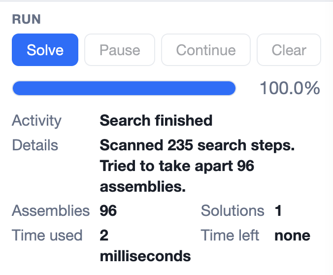

| Button | What it does |
|---|---|
| **Solve** | Runs the search from the start. Old results of this problem are removed. |
| **Pause** | Stops the search where it can be carried on. Save the puzzle to keep the paused search in the file. |
| **Continue** | Carries on a paused search. |
| **Abort** | Shown while the solve runs or is paused, a paused solve opened from a file included. Stops at once and throws away everything kept of this problem's solve: its results, the paused state and any saved search. This can't be undone. |
| **Reset** | Shown in place of Abort once the solve is over. Throws away this problem's results, so it is unsolved again; **Undo** brings them back. |

Below the buttons:

- the **progress bar** and its percentage;
- **Activity**: the solver's state: Ready to Solve, Search active
  (with the name of the solver), Pausing the search, Search paused,
  Search finished;
- **Moves** (sliding and stacking puzzles): the moves of the problem's
  solution, the fewest there are. These puzzles have one solution at
  most;
- **Assemblies**: how many assemblies have been found;
- **Solutions**: how many of them could be taken apart (with the
  disassembly check);
- **Details**: how much the search has gone through. While it runs:
  what it is working on and the search steps scanned, or for a sliding
  puzzle how many moves deep it is and how many arrangements it has
  scanned. For a stacking puzzle, the states (stackings) scanned and the
  search depth: how many moves deep it searched from each end, about
  half the solution's moves. While a sliding or stacking search pauses,
  the line stays and says what keeps it from stopping at once: a sliding
  search finishes the level it is merging, then writes its levels to disk
  so that Continue can carry it on (how much of how much is written);
  this can take minutes once the search is large. Afterwards, the totals
  of every run of the solve. These are saved with the problem in the
  puzzle file, as are the counts and the time used, so they show again
  when the file is opened and the problem chosen;
- **Time used** and an estimate of the **Time left** ("unknown" until the
  solver can tell). Time used counts every run of the solve: Continue
  carries on from the time already used, also after quitting or loading
  a paused solver state.

If a solve fails, the reason appears under the counters.

## Sort by

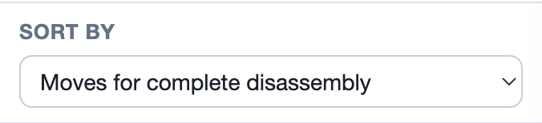

The order the solver keeps the solutions in, as it finds them:

- **Unsorted**: the order they are found.
- **Moves for complete disassembly**: the most moves to take the whole
  puzzle apart first. This is the default.
- **Level**: by [level](/docs/solve-notation/#levels), the highest first.
- **Rotations**: by the number of rotation moves, the most first.

The last three need the disassembly check, and say **(needs disassembly)**
without it. With a **Limit** set, the sort decides which solutions are kept:
the limit keeps the hardest ones found, the ones at the top of the order. You can also sort the list
afterwards by clicking its column headers.

## Step-by-step explorer

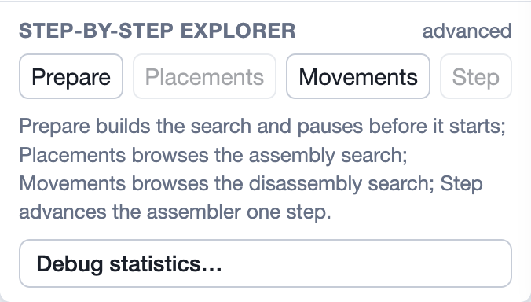

These advanced tools let you look inside a search. They open a drawer below
the 3D view; `Esc` closes it.

- **Prepare** builds the search (every place each piece can go) and pauses
  before the first step, so **Placements** and **Step** have a search to
  show. It removes old results.
- **Placements** browses every position each piece can take in the result.
  Pick a piece, then step or drag through its placements.
- **Movements** browses the disassembly search of the solution shown:
  position by position, which moves are possible. You can analyse a node,
  try your own move, go back to the parent, and prune the tree.
- **Step** advances the assembler by 1, 10, 100 or 1000 steps, or takes it
  back to its start.
- **Debug statistics…** shows the solve's statistics as it runs: how much
  time went into assembling, sliding moves and rotation moves, and where the
  time is going.

## Solutions

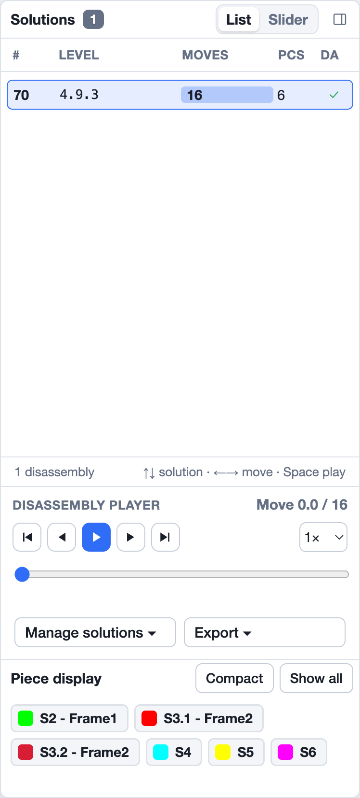

### List and Slider

**List** shows every solution in a table:

| Column | Meaning |
|---|---|
| **#** | The assembly number: the order the search found it. |
| **Level** | The disassembly level, such as `4.9.3`. See [Solve Notation](/docs/solve-notation/). |
| **Moves** | The total moves to take the puzzle apart, with a bar. With rotations, `9+3R` means 9 slides and 3 rotations. |
| **Pcs** | The number of pieces the assembly uses. |
| **DA** | The disassembly status: ✓ stored, ◐ level only (moves not stored), × can't be taken apart, · not checked. |

Click a column header to sort by it, click again to reverse, and a third time
to go back to the saved order. `↑` and `↓` move between solutions.

**Slider** shows one solution at a time, with its numbers in boxes. Drag the
slider or use the arrows to move between solutions.

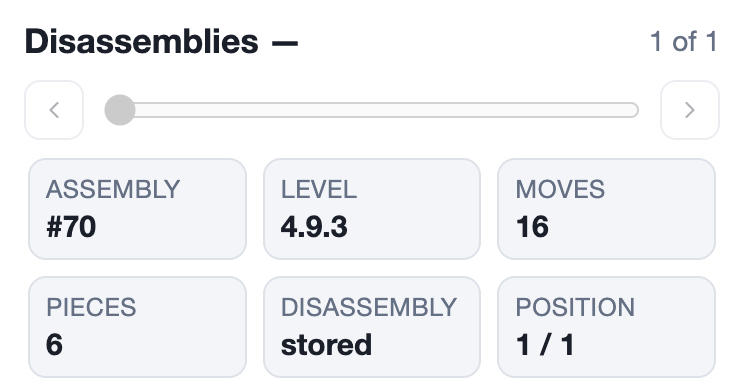

### Disassembly player

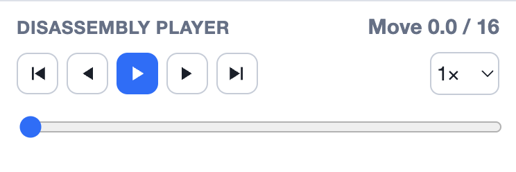

The player animates the selected solution coming apart. The buttons go to
the assembled position, one move back, play or pause, one move forward, and
to fully apart. The menu on the right sets the speed, and the bar below
jumps to any point. Keys: `Space` plays or pauses, `←` and `→` step one move,
`Shift+←` and `Shift+→` jump to assembled or fully apart.

A solution without stored moves shows **Analyse disassembly** instead, to
work its moves out.

### Manage solutions

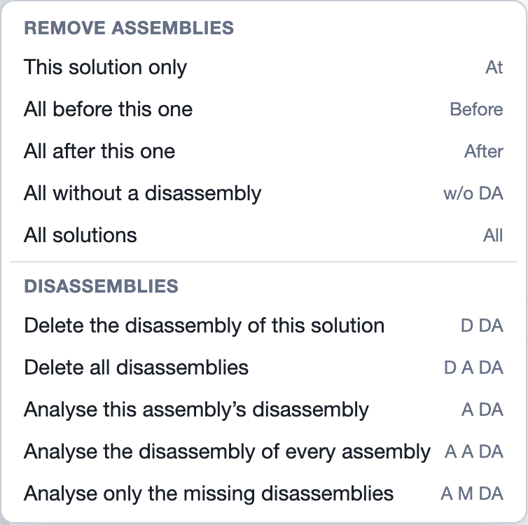

**Remove assemblies**

- **This solution only**: removes the selected solution.
- **All before this one** / **All after this one**: removes every solution
  listed before or after the selected one.
- **All without a disassembly**: removes every solution that has no stored
  disassembly.
- **All solutions**: removes all the solutions of this problem.

**Disassemblies**

- **Delete the disassembly of this solution**: throws away its moves, keeping
  the solution and its level.
- **Delete all disassemblies**: the same for every solution.
- **Analyse this assembly's disassembly**: works out how the selected
  assembly comes apart, and keeps the moves.
- **Analyse the disassembly of every assembly**: works them all out again.
- **Analyse only the missing disassemblies**: only for solutions that have
  none stored.

An analysis shows its progress above the menu, with a **Stop** button. The
analysis uses **Check Rotations** and the **Solver type** as they are set.

**Export to STL** writes each piece the selected solution uses as its own STL
file, for 3D printing. See [Exports](/docs/exports/#export-solution-pieces-to-stl).

### Piece display

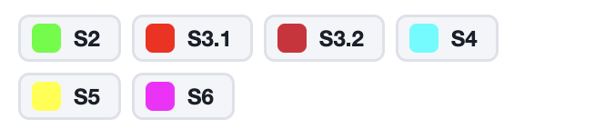

One chip per piece of the solution, showing its label and, if the shape has
a name, the name after it (`S2 - my_label`). Click a chip (or press `Space`
or `Enter` on it) to cycle the piece through **solid**, **wireframe** and
**hidden**, so you can see the pieces inside. **Show all** puts every piece
back to solid. **Compact** shows the labels alone (`S2`); the button then
reads **Full**, which brings the names back. ShapeLogic remembers the
choice.
