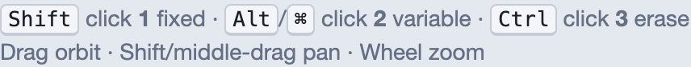
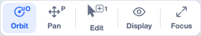
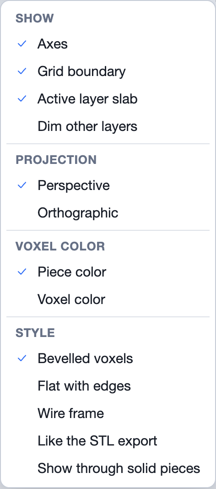
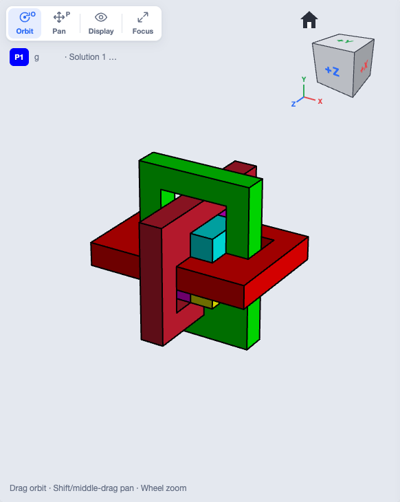
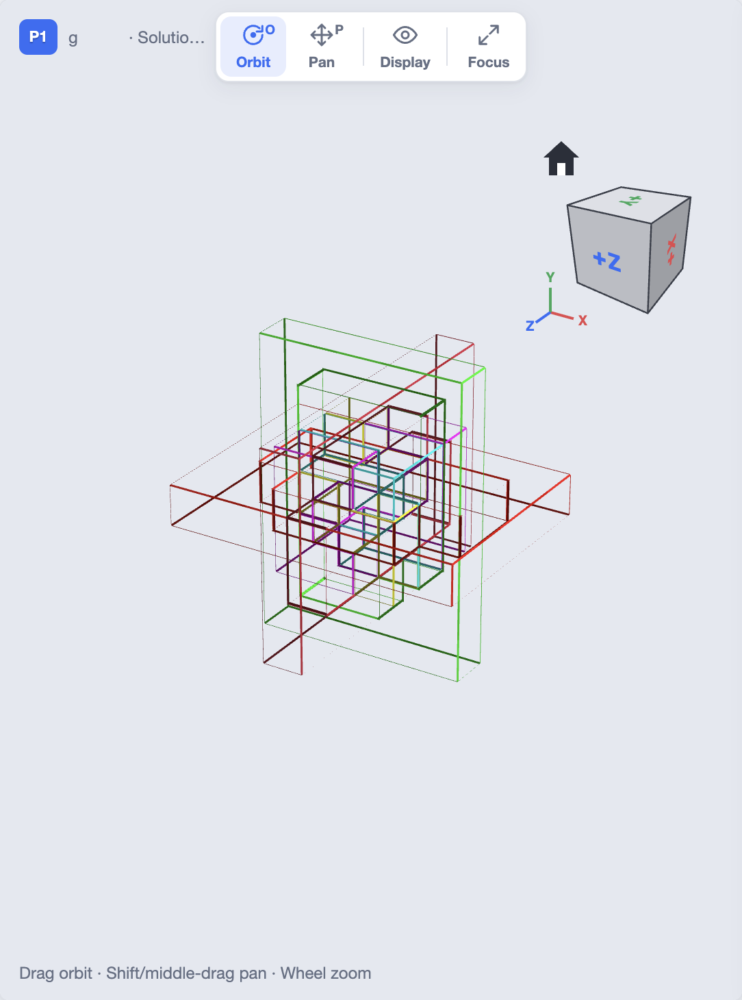
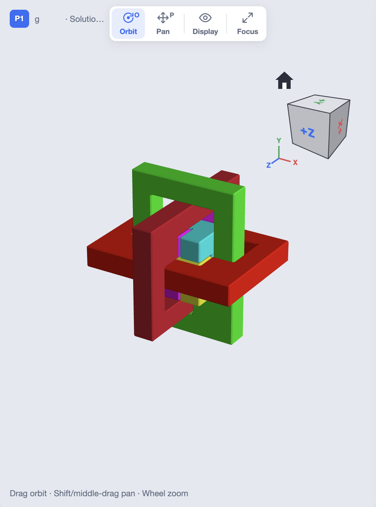
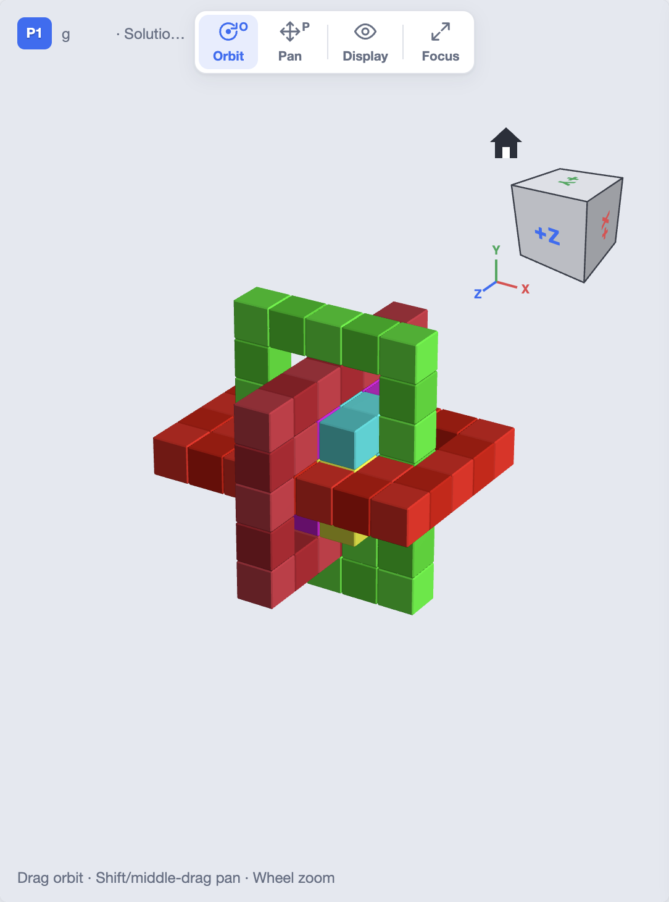
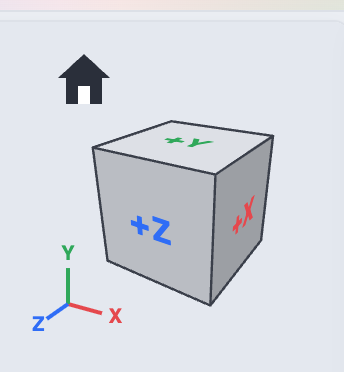

The 3D view fills the middle of the window in every workspace. On the
**Shapes** tab it shows the shape you are editing. On the **Puzzle** tab it
shows the problem's result and its pieces. On the **Solver** tab it shows the
solution you picked, and plays its disassembly.

## Moving around

| To | Do this |
|---|---|
| Orbit (turn the model) | Drag with the left mouse button, in Orbit mode |
| Pan (slide the model) | Drag with the middle button, or hold `Shift` and drag with the left |
| Zoom | Turn the mouse wheel, or scroll with two fingers on a trackpad |
| Go back to the start | Press `Home`, or click the house above the view cube |
| Fit the model to the view | Press `F`; the view keeps its direction |

The hint at the bottom of the view always shows what a drag does in the
current mode.

On the Shapes tab the top line of the hint lists the quick drawing clicks
(`Shift`, `Alt` or `⌘`, `Ctrl`). These are explained in
[Shapes Tab Options](/docs/shapes-tab/#drawing-in-the-3d-view).

## The toolbar

| Button | Key | What it does |
|---|---|---|
| **Orbit** | `O` | A left drag turns the model. `Shift`-drag pans. |
| **Pan** | `P` | A left drag slides the model. `Shift`-drag turns it. |
| **Edit** | `E` | Shapes tab only. Turns 3D edit mode on or off: a plain click in the view then uses the voxel editor's active tool. The button shows that tool's icon and key. |
| **Display** | | Opens the Display menu (below). |
| **Focus** | | Hides the side cards so the 3D view fills the window. The button turns into **Exit**; `Esc` also leaves focus mode. |

A middle-button drag always pans, whichever mode is on.

:::tip
With **Settings ▸ General ▸ Interface density** set to **Minimal**, the toolbar hides itself. Point at the
top of the 3D view, or press `Tab`, `O`, `P`, `E` or `F`, to show it again.
:::

## Display

The **Display** button opens a menu of what to show and how to draw it.

### Show

These appear on the Shapes tab only.

- **Axes**: the x (red), y (green) and z (blue) axes at the corner of the
  shape's grid.
- **Grid boundary**: an outline of the shape's grid box, so you can see how
  much room is left around the voxels.
- **Active layer slab**: the layer you are drawing in the voxel editor, shown
  as a see-through slab in the 3D view. It needs the voxel editor on screen.
- **Dim other layers**: fades every layer except the one being edited. It
  also needs the voxel editor on screen.

### Projection

- **Perspective**: things further away look smaller, as through a camera.
  This is the default.
- **Orthographic**: no perspective. Parallel edges stay parallel, which makes
  it easier to count voxels and line up layers.

### Voxel color

- **Piece color**: each piece is drawn in its shape's color. This is the
  normal view.
- **Voxel color**: each voxel is drawn in its constraint color, the color you
  painted with the voxel editor's **Paint** tool. Use it to check where the
  colors are. See [Color Restrictions](/docs/color-restrictions/).

The **View** menu has the same two choices: **Display Normally with Shape
Color** and **Display with Color Constraint Colors**.

### Style

The style changes how voxels are drawn. The **View** menu has the same
choices, under the names the original BurrTools used.

**Bevelled voxels** (View ▸ Draw Each Voxel Separately) draws every voxel as
its own block with softened edges, so you can count them. This is the
default.

**Flat with edges** (View ▸ Draw Flat Faces with Edges) merges each piece's
faces into flat surfaces with dark outlines. Pieces read as solid objects.

**Wire frame** (View ▸ Draw Wire Frames) draws only the edges, so you can see
through every piece to the ones behind.

**Like the STL export** (View ▸ Draw Pieces like STL Export) draws the pieces
as the [STL export](/docs/exports/#stl) makes them, chamfered and with a small
gap, so you can check a part before printing it.

**Show through solid pieces** can be combined with any style. It shows the
pieces hidden behind the front ones, like an x-ray. It helps when a small
piece sits inside a cage.

## The view cube

The cube at the top right of the 3D view shows which way you are looking,
and turns the view when you click it. Its faces are labelled **+X**, **−X**,
**+Y**, **−Y**, **+Z** and **−Z**. The small axes beside it show the same
directions in color: x red, y green, z blue.

- **Click a face** to look straight at that side of the model.
- **Click an edge** to look at the model from between two faces.
- **Click a corner** to look at the model from that corner, at an angle that
  shows three sides.
- **Double-click a face** to turn the view so the face's label stands
  upright.
- **Click the house** (Home) to go back to the default view, with the model
  fitted to the window. `Home` on the keyboard does the same. Which way the
  axes point in it is the **Z axis direction** setting (below).
- When you are looking straight at a face, **arrows** appear around the cube.
  Click one to turn the view by 90° to the next face. The two **curved
  arrows** at the top right roll the view by 90° clockwise or
  anticlockwise.

Hover over any part of the cube to see what clicking it will do. The view
turns smoothly, so you can follow where you are going.

## 3D view settings

**Settings ▸ 3D view** (`Ctrl+,`, or `⌘,` on a Mac) changes how the view
behaves:

- **Show view cube**: show or hide the view cube.
- **Reverse scroll zoom direction**: swap which way the mouse wheel zooms.
- **Rotation method**: **Free Spin** (the default) has no limits: the model
  turns whichever way you drag it, as far as you like, and can end up upside
  down. It is the original BurrTools method, where the model turns as if you
  were rolling a ball under it. **Top Up** spins the model around its
  vertical axis as far as you like, but tilts it only until you look straight
  down or straight up, so it never turns upside down.
- **Z axis direction**: which way the axes point in the home view and in the
  first view when ShapeLogic starts. **Z Towards** (the default): X across, Y
  up, Z coming towards you. **Z Up**: X across, Z up, Y going away from you.
  The axis that points up is the one Top Up keeps up. A stacking puzzle
  always stands its stack up.
- **Lighting**: shade the pieces so they look solid. Off gives a flat, unlit
  look.
- **Fade out removed pieces**: in a disassembly animation, pieces that come
  free fade away instead of vanishing at once.
